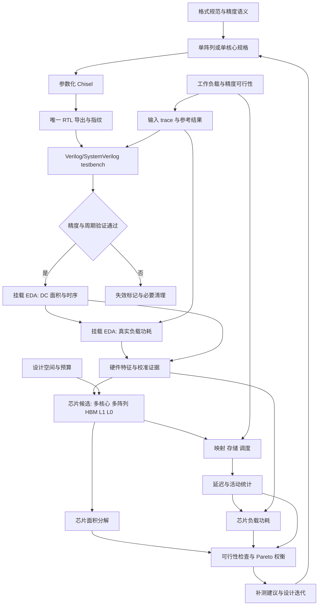

# 项目架构、职责与数据流

## 研究边界

给定目标工作负载与质量要求，在面积/功耗预算以及存储和运行条件约束下，选择 BF16/FP16、MXFP8/6、MXFP4/NVFP4/HiF4 的算力配比及其硬件实现，分析负载延迟的成本收益。

`hw` 提供单阵列/单核的真实实现和证据；`ratio_dse` 将其组合为多核心芯片并评估成本收益。初期聚焦 GEMM 张量计算，不承诺完整 GPU、全部算子或端到端模型模拟；报告必须准确命名其 workload 边界。

## 主数据流

尚无功耗证据的候选可用于明确标注的探索，但不能进入声称完整 area/power/latency 已校准的 Pareto 结论。

## 两个核心部分的交付边界

| 部分 | 接收 | 处理 | 交付 |
| --- | --- | --- | --- |
| hw/spec | 格式来源、微架构问题、目标约束 | 定义精度与周期语义 | 模块/单核规格、验收矩阵 |
| hw/chisel_src + configs | 已明确规格和参数 | 单阵列/单核实现 | 源码与可复现参数 |
| hw/rtl + test | 设计、独立参考、测试/负载向量 | 导出及最终 RTL 验证 | 同一份 RTL、module 映射、验证证据 |
| hw/dc_syn | 通过门禁的 RTL、库和约束 | 挂载 EDA 中综合 | 面积/时序、netlist 和来源 |
| hw/power | 同源硬件、真实负载活动、工况 | 活动回放及功耗测量 | 功耗分解、覆盖率、窗口、active/idle 数据 |
| hw/characterization | 上述证据 | 校验、归一单位、声明边界 | HardwareProfile |
| ratio_dse | profile、workload、chip、scenario | 映射、调度、成本建模、搜索 | CandidateEvaluation、ParetoReport |

## 芯片模型的组成

1. 物理资源层：核心数量、核心类型、各核心阵列组成、共享/独占关系、频率和模式互斥关系。
2. 存储与数据移动层：芯片共享 HBM；按配置作用域定义 L1 cache、L0 buffer 的容量、端口、带宽、延迟和复用。缩放因子、元数据与数据布局开销计入流量。
3. 工作负载层：GEMM 形状、批次、依赖、数值数据/分布、允许精度、转换/缩放要求和结果位置。
4. 映射与调度层：tiling、K 切分、尾块、跨阵列/核心划分、带宽争用、模式切换、同步和可行的计算/传输重叠。
5. 指标层：面积按物理组件计数；功耗由组件模型与执行活动共同决定；latency 来自资源受限的执行时间线。
6. 探索层：生成离散候选，验证预算与精度约束，输出三目标分布、Pareto 前沿和敏感性分析。

L2、NoC、SIMT、控制器、HBM PHY 等按实验声明为显式模型、固定开销或排除项；不能把未知成本自动视为零。建议优先报告计算 die 面积与对应功耗，并另列 HBM/封装边界，最终口径在首个实验前确认。

## 防止边界混淆

- hardware_id 标识物理实现，mode_id 标识运行模式；多模式单元不能重复计面积或假设所有峰值同时可用。
- scope=array/core 与 included_components 决定 profile 如何组合；核心已包含的资源不再与子阵列相加。
- 周期先在对应时钟域定义，再换算时间；不同频率之间不能直接比较 cycle 数。
- 块缩放格式的位宽不等于有效存储成本或算术吞吐，转换、缩放与累加实现都需要证据。
- 本项目不自动假设所有 GEMM 都可改成最低精度；精度可行性由负载规范或外部质量验证提供。

文档描述目标架构，不代表已实现能力。当前不固定框架、工具版本、阵列结构、工艺库、频率、核心数量或比例，不生成假 profile 和假 PPA 数值。
