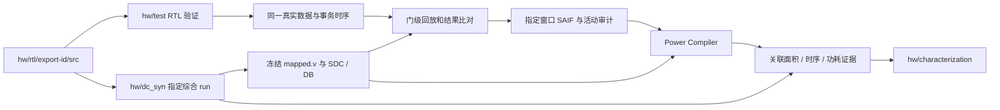

# DP / 单阵列 / 单核心：DC + Power Compiler 负载功耗

**已选定路线：RTL 测试中的真实负载 → 同源门级仿真 → SAIF → Power Compiler 平均功耗。** 面积和时序由 `hw/dc_syn` 产生；本目录接收其冻结网表、约束和证据，输出同一工况下的负载功耗，交给 `hw/characterization`。

当前交付为流程、目录、数据契约、计划配置和 [power-analysis skill](../../.skill/power-analysis/SKILL.md)。**尚无功耗 runner、testbench 生成器或 Tcl 实现，没有执行仿真、综合或功耗分析。** JSON 中的 `planned` 和阈值不能当作已验收配置或测量证据。OpenSTA 仅保留为历史调研对照，不是本流程依赖或自动替代后端。

## 导航与边界

| 文件 / 目录 | 职责 |
| --- | --- |
| [flow.md](flow.md) | 端到端步骤、工艺选择、许可、活动与功耗验收 |
| [paths.md](paths.md) | 全项目 RTL 单一来源、DC 交接、power run 文件树和保留策略 |
| [input-contract.md](input-contract.md) | RTL 测试真实数据、现有 DC v1 交接字段、活动和功耗回执 |
| [window-policy.md](window-policy.md) | 窗口起止、预热、长度增长、收敛与短 trace；含调研来源 |
| [VALIDATION.md](VALIDATION.md) | 文档/配置/skill 检查、当前 DC 接口快照和未执行项 |
| [configs/](configs/README.md) | N22 优先 / N12 备选策略、窗口计划、本机绑定示例 |
| [workloads/](workloads/README.md) | 引用 RTL 测试数据和回执；不维护第二套输入/参考结果 |
| [activity/](activity/README.md) | SAIF/VCD 采集、转换、统计和名称映射约定 |
| [scripts/](scripts/README.md) / [templates/](templates/README.md) | 后续公共驱动与仿真/Power Compiler 模板职责，目前无实现 |
| [runs/](runs/README.md) | 每个 run 独立保存活动、功能比对、PC 原始报告、摘要和指纹；除说明外忽略 |
| [records/](records/README.md) | 经审查的小型长期记录和可恢复归档索引，目前无结果 |

工艺默认策略为 **N22 BWP7T / 100d，TT 0.9 V、85°C**，复用 DC 的公开 profile；**N12 BWP6T / 120a Base+LVT，TT 0.7 V、85°C** 为显式备选。它们来自当前 DC 参考配置，不表示本项目已验收。N22 缺库/许可/时序条件时报告原因，不静默换 N12；切换工艺需新的匹配综合和功耗 run。

## 主要路径

设计 RTL 唯一保存在 `hw/rtl/<export-id>/src/`；DC 衍生网表唯一保存在 `hw/dc_syn/runs/<synthesis-run-id>/netlist/`。power 只读引用两者，不建立自己的设计 RTL 或网表副本。真实输入引用 `hw/test/vectors/` 及验证回执关联的归档，不从参考项目复制数据，不将随机精度测试误标为真实负载。

完整任务窗口作为任务平均功耗口径，包含必要 fill/drain、stall 与模式切换。**DP 计算微基准默认采用 [131072 MAC 固定工作量](configs/windows/dp-fixed-macs-v1.json)**。按用户确认，H16/Q32/E64 每次完整有效 PE 输入调用分别贡献16/32/64 MAC，故需要8192/4096/2048次调用；II=1 时对应相同数量的有效输入周期，完整 burst 还计入 fill/drain 和停顿。初始化/预热在预算之外，排空后才开始计数。

稳定计算窗口另用于单元状态特征；计划从 1024 拍增长至 16384 拍检查收敛。固定 MAC 总量不等于固定调用次数、固定总拍数或已达到稳态；任务/burst 按完成事件确定，不凑拍数重复输入。H16Q32E64 的计数、边界与稳定性细则见 [窗口策略](window-policy.md)。

当前机器只读核查发现 DC X-2025.06 的 SAIF/功耗命令接口；标准许可查询超时，**Power Compiler 可用授权仍待核验**。不能以手册存在代替成功许可或真实运行证据。

历史来源保留：[无 PrimeTime 方法调研](no-primetime-methodology.md)、[参考项目与 skill 审计](reference-flow-audit.md)。当前执行方向以本页及上述流程文档为准，历史 OpenSTA 分支不改变用户已选择的后端。
