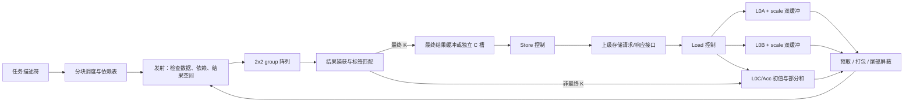

# 张量计算阵列：调研与待审查方案

状态：**讨论稿，未批准实施，未新增阵列 Chisel 或 testbench。** 调研日期：2026-10-24。当前 PE 源码基线为 `0f79378`，18 拍流水等数据来自源码/spec 合同，尚未经过 SV RTL 验收。下文的组织、状态机、布局和周期算例均是本项目方案，不是 NVIDIA 内部实现的复原。

**阅读更新：** 用户进一步要求研究指令内部的 OS 调度。新增 [OS 阵列内部调度调研](os-array-scheduling-research.md)，提供 ISPASS 逆向、DAC/MICRO 论文和 Gemmini RTL 证据。本文中“每段 K 写回 L0C”的结构仅保留为对照基线；group 本地 accumulator、多 context 和延后读取 C 是新的待审查候选。不能把本文的 L0 反馈周期直接用作所有 OS 设计的周期。

## 1. 本次需要确定的边界

目标是一个能完成 GEMM 的张量计算单元：2×2 输出计算单元构成一个阵列 group，组内 A 按行广播、B 按列广播，组间 A 向右、B 向下逐拍传递；配套 L0A、L0B、L0C/Acc、搬运与调度控制。每个输出计算单元采用已有 MN-PE 或 K-PE。

这里的 `ArrayGroup2x2` 是四个完整输出计算单元的连接层，不是恢复旧 PE 内部的 SubPE/PEGroup 算术层级。H/Q/E 名称仍表示每个输出计算单元的 K 容量。

用户已确认的指令场景是 FP4 M8N32 K64/96/128/192/256、FP8 M8N32 K32/64/96/128，并明确：

- 原列表 K196 是笔误，正确值为 K192。
- M8N32 是逻辑指令输出块，物理阵列规模可以参数化，不要求固定为 8×32 个输出计算单元。

必须区分以下四个量，防止把算力、指令和存储块混在一起：

| 名称 | 含义 | 例子 |
| --- | --- | --- |
| `K_job` | 完整 GEMM 的归约长度 | 4096、192 |
| `K_inst` | 一条逻辑 M8N32 计算命令覆盖的 K | FP4 的 96 |
| `K_native(mode)` | 一个 MN/K-PE 一次事务的物理 K 容量 | MN Full 的 Q32/E64 |
| `K_stage` | L0 一个搬运阶段驻留的 K 长度 | 可覆盖一个或多个原生事务，受容量限制 |

完整 GEMM 首版建议定义为 `D=A×B+C` 或 `D=A×B`，C/中间部分和/D 均用 FP32；通用 alpha/beta、融合激活、输出再量化独立列为后续 epilogue，不能默认已经支持。FP4 必须明确 MXFP4、NVFP4 或 HiF4；FP8 必须明确 E4M3/E5M2 及是否带 MX scale。

## 2. 调研结论及证据边界

### 2.1 已有工程能复用什么

参考工程 `Quant_LLM_Chip_Codesign` 的源码基线为 `0ddc5f7c21082dbce73d992a4d33a5a331f1e0bc`，本轮只读参考：

| 相对该工程的文件 | 实际职责 | 对本项目的意义 |
| --- | --- | --- |
| `HW/PE/SystolicArray/PETileArrayGroup2x2.scala` | 四个 PETile，A 行共享、B 列共享，各自 C/D | 可参考广播连接关系 |
| `HW/PE/SystolicArray/PETileGroupedSystolicArray.scala` | 入口错拍、组间寄存器、C 对齐、D 去错拍、批次 busy/last | 是阵列传输包装，还不是完整 GEMM 引擎 |
| `HW/PE/SystolicArray/PETileMixedSystolicArray.scala` | 按格式启用不同物理位置，要求相同物理输入宽度 | 参考异构组激活；其环境变量参数入口不沿用 |
| `HW/doc/architecture/systolic_array/compute_system_proposal.md` | 搬运、L0、累加依赖、结果预留的方案文档 | 只作为方案来源，不能当作已经运行的系统 |

本项目已实现的 MN/K-PE 是按事务输入 C、18 拍后输出 D 的 `Valid` 流水，II=1，无内部反馈或反压。因而还缺少：GEMM 循环、内存接口、buffer 所有权、同一输出的累加依赖、尾块、完成与错误语义。原项目的批次 cfg/last 控制不能直接替代这些功能。

### 2.2 PTX：借鉴指令和完成协议，不推断物理阵列

官方 PTX 示例包括 FP8 `mma.sync.aligned.m16n8k32`，块缩放 FP4 `m16n8k64`。`tcgen05.mma` 使用描述符、异步执行，普通 `tcgen05.commit` 配合 mbarrier 跟踪之前操作的完成。当前在线 PTX 9.4 的 shape 表还列出 FP4 K96，但限定目标 `sm_103a/sm_107a`；不能把不同目标的能力合并称为 SM100 能力。M8N32 在本项目中应定义为自己的逻辑指令形状。[PTX：mma、tcgen05 shape 与同步章节](https://docs.nvidia.com/cuda/parallel-thread-execution/)

CUTLASS 的公开 tcgen05 编程流将 A/B 分阶段放入 shared memory，并让累加值驻留 TMEM；加载与 MMA 之间用阶段所有权和完成机制协调。这支持我们将 A/B 输入缓存与 C/Acc 生命周期分离的选择，但不意味着项目需要照搬 TMEM 的容量或布局。[NVIDIA tcgen05 编程指南](https://docs.nvidia.com/cutlass/latest/media/docs/pythonDSL/guides/mma/tcgen05_programming.html)

CUTLASS pipeline 的 acquire、wait、release 分别控制空槽获取、数据就绪和消费完成；TMA 路径还跟踪预期传输字节。对本项目的启示是：发出读请求不等于数据就绪，发出计算不等于 buffer 已经安全释放。[NVIDIA pipeline API](https://docs.nvidia.com/cutlass/latest/media/docs/pythonDSL/cute_dsl_api/pipeline.html)

CUTLASS 将 GEMM 分成多层 tile 与 K 主循环，软件 tile 不等同于一条 MMA 或一个物理阵列。这里借鉴分层切分和流水复用；不实现 CUDA warp、线程寄存器 fragment 或 GPU 指令解码器。[Efficient GEMM](https://docs.nvidia.com/cutlass/latest/media/docs/cpp/efficient_gemm.html)、[GEMM 3.x 模型](https://docs.nvidia.com/cutlass/latest/media/docs/cpp/gemm_api_3x.html)

### 2.3 公开硬件：Gemmini 的控制划分

Gemmini 将 load、execute、store 分离，并通过队列和依赖管理协调 scratchpad/accumulator；其 LoopMatmul 将大矩阵展开为小块，使用双缓冲重叠搬运和计算。可借鉴这些控制职责，但其标量 PE、数值格式和阵列数据流不直接替代本项目的向量点积 PE。[Gemmini 架构与 LoopMatmul](https://github.com/ucb-bar/gemmini#major-components)

本项目首版可采用顺序 job 加微块依赖表，不必直接实现通用 ROB。NVIDIA 的 CTA 调度、Gemmini 的 RoCC/TLB 也不属于当前单张量计算单元的必要边界。

## 3. 建议的数据通路

上级先用可停顿的读写请求/响应接口表达，测试环境提供内存模型；HBM 控制器、L1 cache 命中逻辑不塞入阵列 RTL。它们是 ratio_dse 的上级存储边界，后续如需 AXI 再接 adapter。

`L0C/Acc` 是 C 初值和跨 K 部分和的同一逻辑存储，不在每一轮 K 重读原始 C。最终 D 可以采用独立小缓冲，或占用另一个 C bank/槽直到写回完成；两种方案都要计面积和端口。建议首版独立 D 缓冲，使反馈读写与慢速上级写回容易验证，D 容量由输出 tile 数决定。

### 3.1 2×2 group 和组间时序（L0C 反馈基线）

一个 group 输入两条 A 向量、两条 B 向量和四个 C，生成四个独立 D。A0 用于上行两个单元，A1 用于下行两个单元；B0 用于左列，B1 用于右列。组内不进行跨 M/N 的结果相加。

设物理阵列为 R×S 个输出单元，R/S 均为正偶数：

- group 网格为 `Gm=R/2, Gn=S/2`。
- `(gr,gc)` 的 A/B 在 `t_issue+gr+gc` 相遇：左边界 A 延迟 gr 拍，上边界 B 延迟 gc 拍，每跨一组再寄存一拍。
- scale、格式、K mask、序号必须与对应数据一起走；即使算术禁用，中间组也要继续转发有效数据。
- 基线将 C 延迟 `gr+gc`，并将结果延迟 `dmax-gr-gc`，其中 `dmax=Gm+Gn-2`。全部结果在 `L_array=18+dmax` 后对齐。
- 这是按当前核心延迟推导的合同，实际边沿约定在 SV TB 中验收；复位同时清空 valid、标签和预留计数。

上述整笔微块对齐返回便于使用一个结果标签队列。group 本地 C bank、本地反馈和分散写回则是 OS 调研重点，可减少全阵列 D 对齐寄存器与长连线，但需要逐组完成位图和更复杂的调度。两者均为待审查候选，不应在没有测量时声称其中一者更优。

### 3.2 物理尺寸和逻辑指令独立

以一条 M8N32 为例，微块数 `I=ceil(8/R)×ceil(32/S)`：

| 物理输出单元 | 2×2 group 数 | 指令内独立输出微块 I | 基线 L_array |
| --- | ---: | ---: | ---: |
| 2×2 | 1 | 64 | 18 |
| 2×4 | 2 | 32 | 19 |
| 4×4 | 4 | 16 | 20 |
| 4×8 | 8 | 8 | 22 |
| 8×32 | 64 | 1 | 36 |

单个 2×2 适合验证广播；4×4 包含两个方向的组间传递，适合作为首个完整波前验证配置。以上均为候选，不能据此确定最终面积最优尺寸。固定 8×32 会有 256 个完整 MN/K 输出单元，必须同时提供其输入和 C/D 带宽。

## 4. K 方向切分与数值语义

### 4.1 指令可用小核心分次完成

若每个输出位置使用 `MN_PE_H16Q32E64`，则 FP4 原生 K64、FP8 原生 K32：

| 模式与 K_inst | 原生事务的有效 K 序列 | 事务轮数 |
| --- | --- | ---: |
| FP4 K64 | 64 | 1 |
| FP4 K96 | 64 + 32（后一次物理 K64 尾部置零） | 2 |
| FP4 K128 | 64 + 64 | 2 |
| FP4 K192 | 64 + 64 + 64 | 3 |
| FP4 K256 | 64 + 64 + 64 + 64 | 4 |
| FP8 K32/64/96/128 | 分别为 1/2/3/4 段 K32 | 1/2/3/4 |

首个 K 事务使用 C 或零；后续事务使用上一次 FP32 部分和：`P_next=Core(A_slice,B_slice,P_prev)`。只在整个输出块最后一次 K 更新后对外写 D，不能每段重复加 C。

### 4.2 K-PE 提供空间并行的另一个设计点

四个 Full PE 的 K-PE 为 H64Q128E256，可在一个原生事务中覆盖上述 FP8 K128/FP4 K256，并共享一次 C/D 路径。其他已合法的静态组合包括 E64+E32=E96、三个 Q32=Q96；实际 H/Q/E 合计由有序 PE 列表推导，不能只看 E 容量推断 Q 容量。

当前 KPE 的 enable 只随格式能力变化，**还没有按指令 K 长度关闭某个 PE 的动态 mask**。短 K 可以由上游对无效 A/B 元素置零、补安全 scale 来适配固定端口；若要减少切换，应另行设计 PE/word/block 级使能，并保证 inactive NaN/Inf 不污染结果。置零可实现功能，不等于硬件资源已消失或已经节省对应比例功耗。

K 扩展和 M/N 扩展必须在相同资源预算下比较。例如同样数量的 Full dot PE，可比较 4×4、每输出四个 PE 的 K-PE，与 8×8、每输出一个 PE 的 MN-PE。两者乘法资源数量相同，但 C/D 路径数、互连、bank、位宽和频率不同，因此总面积并不相等。

### 4.3 分次累加与一次规约不保证 bit-exact

多次 MN-PE 产生多次 FP32 舍入；一次 K-PE 会先组合多个 dot，再做一次 C/D 处理。本项目 PE 内部还有明确的有限窗口 RTZ 对齐，两种组织可能产生不同数值结果。

建议保留“每个候选有明确数值合同”的探索方式：各自对独立参考模型做 RTL bit-exact 验证，再以高精度参考和负载质量评估候选之间的误差。若用户要求同一逻辑指令跨所有硬件配置都 bit-exact，则必须固定规约树/截断/舍入边界，可能需要修改当前核心，不能只靠 scheduler 保证。

### 4.4 尾块保持原 scale 分组

MX 的基本 scale 块按 K32，NVFP4 按 K16；本项目打包时保持输入量化的原分组，不因物理 K_native 改变量化结果。半个真实块保留原 scale，只将无效元素置零；完全填充的块使用有限单位 scale 和全零 A/B，不能用可能表示 NaN 的 scale 编码。[OCP MX 1.0](https://www.opencompute.org/documents/ocp-microscaling-formats-mx-v1-0-spec-final-pdf)

用户确认的指令 K 列表全部对齐 K32，适合保持 MX/NV 原 scale 分组。完整 GEMM 的一般尾块仍可通过 k_valid 和零填充处理。建议首版内部切分起点按 scale 边界对齐，非整块只出现在末尾；任意不对齐子矩阵另定义带全局 scale 索引的 gather/prefix-mask 布局后再支持。

NVFP4 的全张量 FP32 scale 当前不在核心接口内。若采用完整双层缩放，需定义 `D=(sA_global*sB_global)×Dot_blockscaled+C` 的执行位置；不能先把 C 加进未全局缩放的 dot，再对 D 整体乘 scale。首版必须明确 global scale=1 的测试边界，或批准增加相应数据路径。[NVIDIA NVFP4 数值定义](https://docs.nvidia.com/deeplearning/transformer-engine/features/low_precision_training/nvfp4/nvfp4.html)

## 5. 数据 layout：数学矩阵、搬运格式、物理 bank 分层

建议初版由软件/测试生成器预排布 A/B；硬件不在首版隐含执行任意转置或重新量化。预处理时间与额外流量单列，不能从端到端延迟中无说明地消失。

### 5.1 搬运平面

逻辑视图：`A[m,k]`、`B[k,n]`、`C[m,n]`。建议定义 `layout_version=1` 的概念合同，正式编号待审查：

| 平面 | 面板内布局 | 原因 |
| --- | --- | --- |
| A data | `[k_stage][m_local][k_in_stage]`，K 连续 | 直接读一行的点积向量 |
| B data | `[k_stage][n_local][k_in_stage]`，K 连续 | B 预转置，使一列的点积向量连续 |
| A/B scale | `[k_stage][m_local 或 n_local][scale_block]` | 与元素 plane 分开，便于独立 bank 和复用 |
| C/Acc 与 D | `[microtile_m][microtile_n][r][s]`，块内 row-major | 一次发射读 R×S 个 C，返回写相同位置 |

每个 plane 使用独立的 base、stage stride、vector stride，均声明字节单位和地址对齐。不要让一个 lda/ldb 同时表示数学 stride、打包字 stride 和 SRAM bank 地址。还需保存原始 M/N/K、补齐尺寸及有效尾长。

打包字为 16 bit，小 K 索引放低位：H 每字一个元素；Q8 每字两个 byte；Q6 每个 byte 的低六位有效；E4 每字四个 nibble。字节序为小端。比如连续 FP4 元素 a0..a3 放在 bit[3:0]、[7:4]、[11:8]、[15:12]；并非从高位开始。

MXFP4/MXFP8 scale 按全局 K32 编号，NVFP4 按 K16 编号。HiF4 另保留 group metadata plane，待正式语义确认后定义其搬运合同；不得把 HiF4 当成只换 scale 编码的 MXFP4。

### 5.2 L0 bank 映射

以同构 R×S 阵列、一个面板 `M_L×N_L` 为例：

- A：行 lane=`m_local mod R`；lane 内行号=`floor(m_local/R)`；K 向量再沿位宽切成多个物理 SRAM bank。
- B：列 lane=`n_local mod S`；lane 内列号=`floor(n_local/S)`；K 向量同样按端口宽度拆分。
- C/Acc：逻辑 bank=`(r,s)`；地址=`context_base + floor(m_local/R)×ceil(N_L/S)+floor(n_local/S)`。
- D：采用相同的输出位置映射，但存储所有权与 C/Acc 分开。

对于单条 M8N32 和 4×4 物理阵列，微块编号 `u=8×floor(m/4)+floor(n/4)`，范围 0..15；bank=`(m mod 4,n mod 4)`。例如 C[5,10] 位于微块 u=10、bank(1,2)。每个 C bank 需要至少 16 个 FP32 项才能容纳这一条指令的全部输出，增加上下文时增加深度。

这些是逻辑 bank，不代表一定实例化 R×S 个很小 SRAM 宏。可按宏宽度组合多个相同访问地址的 slice，但必须能实现目标每拍读/写宽度。C/Acc 建议 1R1W；同地址读写语义通过 scoreboard 避免或由明确 bypass 解决，不依赖仿真器的未定义读写顺序。

A/B 双缓冲需在填充槽与计算槽之间具备实际独立端口或 bank；同一个单端口 SRAM 的两个地址区不能自动提供并发读写能力。scale bank 也计入端口预算。首版不复制 NVIDIA swizzle：先由本项目的并发访问证明 bank 无冲突，再评估是否需要置换。

### 5.3 容量与带宽例子

仅计算一条 M8N32 FP4 K256，紧凑输入有效载荷为 A=1024 B、B=4096 B，MX scale 合计 320 B，NV scale 合计 640 B；FP32 C、D 各 1024 B。FP8 K128 的数据同为 5120 B，MX scale 合计 160 B。这些是每条指令的数据量，不是每拍外部存储流量。

若 L0 每个槽驻留整个上述 K_inst，并选择两套 A/B 槽、一套 C/Acc 和一套 D，MXFP4 容量下限为 `2×(5120+320)+1024+1024=12928 B`。它不含宏宽深取整、FIFO、标签、ECC、HiF4 metadata；若每个槽仅驻留一个 K_native 块，容量会不同。

物理入口的原生事务数据宽度为 `(R+S)×K_native×b/8` 字节，C 和结果各为 `4×R×S` 字节。例如 4×4、FP4 K64 为 A/B 共 256 B/事务，C 64 B、D 64 B；8×32、FP4 K256 则为 A/B 共 5120 B/事务，C/D 各 1024 B。II=1 的持续流需要相应本地吞吐，软件搬运复用不能消除这些物理连线。

当预取寄存器保持 A 横跨多个 N 微块时，可减少 L0A 实际读取次数。分别统计外部加载字节、SRAM 读写字节、阵列传输跳数和有效 MAC，不能用同一个 bandwidth 值替代全部层次。

## 6. 调度、状态机和反压

### 6.1 控制器划分

以下是逻辑职责；不要求每一行都单独建一个 Module 或巨大 FSM。

| 对象 | 状态/推进条件 | 管理的资源 |
| --- | --- | --- |
| Job 控制 | IDLE → VALIDATE → RUN → DRAIN → WAIT_STORE → DONE | 任务合法性、总计数、完成/错误 |
| Load 控制 | ALLOC → REQUEST → RECEIVE → READY | 读请求 ID、预期/完成字节、bank 写入 |
| A/B 槽 | FREE → FILLING → READY → READING → FREE | 各自 stage/generation/读取引用数 |
| 计算调度 | SELECT → WAIT_OPERANDS → ISSUE → ADVANCE | 面板、微块、K slice；依赖和 credit |
| 输出微块依赖 | READY(k) → IN_FLIGHT(k) → READY(k+1) / FINAL | 同一 C 地址的 RAW/WAW |
| C/Acc 上下文 | FREE → INITIALIZE → ACTIVE → FINAL_CAPTURED → FREE | 整个 MN 面板跨所有 K 的部分和 |
| D 槽与 Store | FREE → RESERVED → RECEIVING → READY → STORING → FREE | 结果预留、已写位图、上级写响应 |
| 错误路径 | VALIDATE_ERROR 或 FAULT_DRAIN | 停止新发射，接收在途结果/响应后报告错误 |

RUN 期间 load、issue、capture、store 并行工作；不能用一个 LOAD→COMPUTE→STORE 大状态机将所有阶段强制串行。A/B 槽的 generation 独立于 C/Acc 上下文，不能共享一个全局 ping-pong 位。

初版允许一个 job 活跃、多个输出微块/指令 tile 交错；这不需要多 job 乱序。错误响应和复位后的迟到内存响应必须按 job/epoch 拒绝写入新槽；如果上级接口不支持取消请求，则必须排空或有明确的共同复位合同。

### 6.2 发射条件

一次原子发射须同时满足：A/B/scale 就绪、相应 C 已提交且读出、预取完整、结果位置已经预留、标签队列有位置、接口合法。

当前核心不可在中途停顿，因此所有反压都在发射前处理。若结果使用 FIFO，必须维持 `occupied+reserved<=capacity`；仅检查“当前 FIFO 非满”无法保护 18 拍及传输链中尚未返回的结果。发射时 reserved 增加，捕获时转为 occupied，消费时释放。

标签至少包含 job/epoch、context/generation、microtile_id、k_slice、k_last、lane_mask、目的槽。只在实际 ISSUE 时入队，只在有效结果时出队。`last` 只是序列信息，不能替代目的地址、依赖和存储完成计数。

A/B 槽在其最后一次读已被预取寄存器可靠接收后可释放，不必等整个 GEMM 结束；C 上下文在最终结果已转移后释放；D 槽必须等最后写响应完成才释放。DONE 必须等计算、标签、读写请求全部完成。

### 6.3 循环次序与反馈依赖

建议 C/Acc 驻留一个输出面板：先初始化 C，再按 K_stage/K_slice 推进；每一段 K 扫描多个不同的输出微块，同一 A 行块跨 N 微块复用。下一段 K 对某微块的更新仅在该微块前一结果已经提交后发射，不必等待整个阵列全局排空。

独立微块越多，越容易覆盖反馈延迟。设一个调度面板有 I 个独立微块，每个需要 S_K 轮 K，发射间隔为 II；`L_feedback` 为同一微块从一次发射到下一次可使用结果发射的间隔，包含阵列、捕获、SRAM 和预取延迟。

在操作数已经就绪、端口足够、结果空间足够的条件下，轮转扫描的计算时间跨度为：

`T_span=(S_K-1)×max(I×II,L_feedback)+(I-1)×II+L_array`。

这是首笔发射边沿到末笔结果边沿的差，不含初始化/首次搬运/最终存储，也不自动等于 end-to-end latency。当 `I×II<L_feedback` 时有依赖气泡，双缓冲不能消除它。

示例：4×4、MN Full、L_array=20；**仅为演示**假定捕获/重新读取/预取合计再需 3 拍，故 L_feedback=23，II=1。一条 M8N32 有 I=16：

| 工作量 | 发射周期（首笔为 0） | 最后一笔结果周期 / 时间跨度 |
| --- | --- | ---: |
| 1 轮 K | 0..15 | 35 |
| 2 轮 K | 0..15，23..38 | 58 |
| 3 轮 K | 再加 46..61 | 81 |
| 4 轮 K | 再加 69..84 | 104 |

每两轮间有 7 个空发射周期。若同一面板安排两条独立 M8N32 输出块（I=32），在上述理想假设下可以用其他输出隐藏反馈；同时要增加 C/D 容量并满足数据供应。物理 8×32 只有 I=1，跨 K 反馈更需要多个指令上下文，不能因阵列更大就认为单条长 K GEMM 能每拍推进。

## 7. 首版参数与后续异构支持

| 类别 | 建议字段 | 生效时机 |
| --- | --- | --- |
| 硬件生成 | rows/cols、固定 group=2×2、MN/K 核类型、有序 PE 配置、L0 bank 宽深与端口、预取/标签/结果深度、上级接口宽度 | JSON → 集中参数定义 → elaboration |
| 能力表 | 支持格式对、各模式 K_native、逻辑列映射、scale 粒度、原生延迟、layout 版本 | 由硬件配置推导，不能手填互相矛盾的副本 |
| 任务 | M/N/K、plane 基址/stride、格式、C 初始化模式、舍入、tile 大小、任务 ID | 运行时命令 |
| 微操作 | m0/n0/k0、k_valid、上下文/槽、有效输出 mask、k_last | 调度器推导 |

参数继续放 `config/`，不增加隐式环境变量。用户审核后，源码可增加 `array/`（组连接/波前）、`buffer/`（bank/预取）、`control/`（调度/搬运），所有 Scala 仍与 spec 同路径一一对应。本稿没有创建占位 Scala 或承诺模块文件数。

为了服务配比研究，后续异构阵列建议以完整 2×2 group 为配置粒度、优先按列成组布置 Full/Q/E 能力。某格式下 inactive 组仍需传递其他组的 A/B；逻辑 N 到物理列的映射按模式生成。第一轮验证建议同构，第二轮再验证异构。异构各列 K_native 若不同，不能把不同长度的 K 片段塞进同一简单波前而假装它们同时完成；需统一公共 K 片段并屏蔽、或分独立子阵列调度，并把效率差异纳入 DSE。

## 8. 审核后应完成的验证与性能观测

最终验收是生成 RTL 的 Verilog/SystemVerilog TB；Chisel 展开不替代它。建议按以下顺序明确后再实现：

1. 2×2 广播连接与 4×4 双方向波前：用不同坐标/不同 scale 的输入识别 A/B 交换、错拍、错标签，覆盖气泡和复位。
2. 单条 M8N32：覆盖全部用户 K 列表、初始 C/零、Q/E 格式及 scale 边界，检查只加一次 C。
3. 完整 GEMM：M/N 非整块、K 多 stage、多指令上下文，覆盖一般 K 尾部、不同原生 K 和 FP32 部分和反馈。
4. 内存协议：读写随机延迟/反压、返回顺序、结果 buffer 满、C bank 同地址风险、迟到响应、槽切换 generation、错误排空；无越界写、无重复/遗漏输出。
5. 数值证据：独立软件模型模拟规定的切分与截断/舍入作 bit-exact oracle；另用高精度数学参考报告误差。未经验证不能将 NVIDIA 结果当作本实现 bit-exact golden。
6. 性能计数：有效/填充 MAC、发射次数、依赖/数据/端口/credit 停顿、fill/drain、各级字节、scale 流量、group 活动周期和阵列传输次数。总延迟从任务接收到最终写完成响应。

真实活动用于后续 power；面积拆分为 dot PE、共享/独立 C/D、传输寄存器、L0 宏及端口、预取/输出缓冲、控制。只有通过该份 RTL 的数值/协议回归后，才允许进入挂载环境 DC/power。本稿的周期数字均为解析假设，不是测量数据。

## 9. 本轮希望审核的选择

已确认：M8N32 是逻辑指令块、物理 R/S 参数化；FP4 列表中的尺寸为 K192。以下事项仍需审核后再写阵列代码：

| 待定项 | 本稿建议 | 改选的影响 |
| --- | --- | --- |
| 第一份验证配置 | 同构 4×4，2×2 分组；MN 与 K-PE 分别可生成 | 先证明波前/累加/搬运，再进行异构比较 |
| C/D 路径 | FP32、每个原生 K 事务有明确舍入；结果先整笔对齐 | 更宽不舍入的内部 accumulator 或分散写回需另审微架构 |
| layout | 软件预排布，A/B K 连续，独立 scale plane | 硬件转置/任意 gather 增加数据通路和成本 |
| NVFP4 全局 scale | 明确选择 unit-global 范围或增加正确的缩放路径 | 不解决时不能宣称完整 NVFP4 GEMM |
| 首版命令 | GEMM 描述符 + 内部 M8N32 微指令；单 job、多输出上下文 | 独立公开 LOAD/MMA/STORE ISA 可后续加，不影响内部职责划分 |

上述“建议”仍是待审查选择；当前只完成调研和设计记录。
