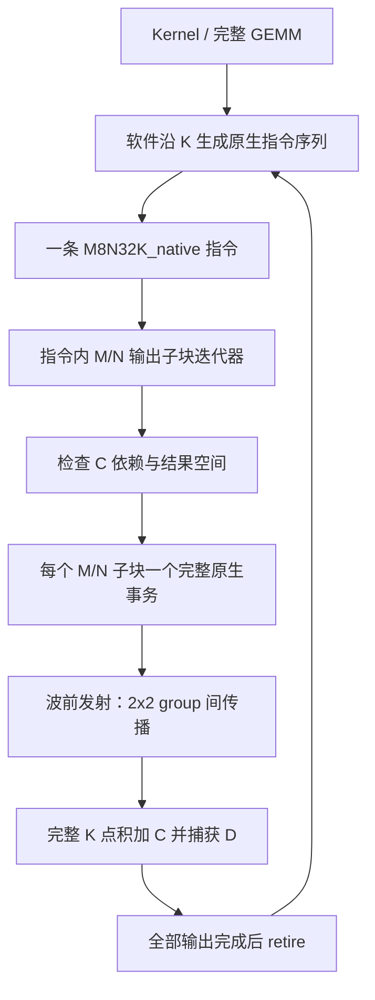

# 指令内部的 OS 阵列调度：论文、RTL 证据与设计选择

2026-10-24；状态：**调研与讨论，未批准实现**。本文补充 [阵列总览](array-design-discussion.md) 中不足的“逻辑 MMA 指令 → 更小物理 tile → 阵列执行步骤”这一层。没有新增 Chisel、RTL 或测试代码，也没有在 GPU 上运行逆向实验。

已确认需求：逻辑指令 M8N32，FP4 K64/96/128/192/256，FP8 K32/64/96/128；物理阵列尺寸参数化，采用 2×2 group 组内广播、组间脉动。

**本轮修订：** 用户提出原生指令 K 与计算单元容量绑定，指令内部只切 M/N。本稿据此修正默认例子：E192 配置的一条 M8N32K192 在 4×4 阵列上有 16 个输出子块操作；E64 配置完成相同工作量则由软件组织三条 K64 指令，共 48 个操作。后文的 K 反馈和 context 轮转改为跨指令问题。该方向仍在与 Ascend 可变 K 矩阵指令进行比较，不视作完整阵列方案已批准；见 [Ascend 对照](ascend-cube-scheduling-research.md)。

## 1. 先修正 OS 的使用范围

前稿默认每个 K_native 事务都从 L0C 读 C、将 FP32 部分和写回 L0C。该方案能实现 GEMM，但只是在 **L0 层保持输出面板**；现有 MN/K-PE 本身没有驻留累加状态，不能直接称为 PE 内的 output-stationary 阵列。

本地 OS 的候选是：**输出子块映射到固定 group/输出槽，本地累加状态跨多条更新同一输出的原生指令保留；A/B 及 scale 随各条指令进入，最终结果才排出到 L0C/D。** 一个物理输出槽可有多个独立的 accumulator context，用来时间复用多个输出子块。若仅执行一条完整原生 K 指令，每输出只更新一次，不必为不存在的内部 K 循环配置反馈 context。

需要分别定义三层“驻留”：

| 层级 | 什么保持不变 | 什么时候允许写回 |
| --- | --- | --- |
| 单条逻辑指令 | 输出 tile 的架构地址、M/N/K 语义 | 对应子块完成即可捕获/按可见性合同搬出；全部子块完成才 retire |
| group/输出槽本地 | context 对应的输出坐标与部分和 | 完成约定的 K 范围，或显式 spill |
| L0C 面板 | 同一 GEMM 输出区域 | 全部指令 K 更新完成后对上级存储输出 |

“一条指令内本地 OS，跨指令边界写 L0C”是可实现的边界。若还要跨多条指令保持同一输出本地驻留，应新增显式的 continue/final 和 accumulator 生命周期合同，不能让软件猜内部状态。完成一条命令与完成整项 GEMM 是不同事件。

## 2. 有哪些直接相关的证据

### 2.1 Tensor Core 逆向：指令以下确实可以继续分步

**Raihan、Goli、Aamodt，ISPASS 2019，Modeling Deep Learning Accelerator Enabled GPUs。** 第 III-D/E 节、Fig. 10/11 将 Volta WMMA 的执行拆成 HMMA set/step，并定位每个步骤覆盖的输入与输出子块。例如混合精度时，一个 threadgroup 的 step 对应 A 的 2×4 与 B 的 4×4 相乘并更新 2×4 输出。Turing 没有同样的 step 标记；作者根据延迟与访问模式提出内部状态机排序的可能解释，**没有给出 NVIDIA RTL 的证明**。[论文](https://arxiv.org/pdf/1811.08309)

对本项目的启示：逻辑指令形状可以大于一个物理执行步骤；应为 descriptor 定义子块迭代器、operand selection 和完成计数。不能将 Volta/Turing 的线程 fragment、步骤数或延迟直接当作 Blackwell FP4 的内部组织。

**Sun 等，Dissecting Tensor Cores via Microbenchmarks，arXiv:2206.02874。** 第 IV/V 节区分完成延迟与吞吐，并扫描指令级并行度和活跃 warp 数。其测量支持“独立累加链数量会影响流水利用率”；不足以唯一确定累加寄存器数量或内部 PE 布局。[论文](https://arxiv.org/pdf/2206.02874)

因此，我们可以采用“多 context 隐藏依赖”的设计方法，但 context 数量应从本项目反馈延迟与端口预算推导，不能按 GPU warp 数照搬。

### 2.2 接近 2×2 广播结构的 STA 研究

**Liu、Whatmough、Mattina，Systolic Tensor Array，arXiv:2005.08098，2020。** 第 III 节和 Fig. 2/3 把标量 PE 扩展成 Tensor-PE：一个局部二维块内有多个向量点积单元，相邻块通过寄存器传递操作数，输出累加值驻留。该研究与“局部 2×2 输出 × K 向量点积 + 块间脉动”在结构上非常接近。其研究对象是 INT8/INT32，不能把它的逐拍累加时序或 PPA 数字移植到本项目浮点路径。[论文](https://arxiv.org/pdf/2005.08098)

本项目的 `ArrayGroup2x2` 可以沿用这种功能划分，但 group 仍只是 MN/K-PE 外部的连接与状态管理，不恢复旧 SubPE/PEGroup 算术层级。scale 随 A/B 向量传播；浮点累加依赖另行处理。

### 2.3 Gemmini：可检查的 OS 硬件控制，而不只是 API

**Gemmini，DAC 2021。** 论文提供全栈生成器及阵列/存储/控制架构。[作者版论文](https://people.eecs.berkeley.edu/~ysshao/assets/papers/genc2021-dac.pdf)

本轮进一步读取公开 RTL，固定参考 commit 为 `8c3f9923a44a2fe2c7930587be297d6d4f8c09ca`；下列源代码比只读 README 更直接：

| 文件及定位 | 能核实的机制 | 本项目借鉴的职责 |
| --- | --- | --- |
| [PE.scala](https://github.com/ucb-bar/gemmini/blob/8c3f9923a44a2fe2c7930587be297d6d4f8c09ca/src/main/scala/gemmini/PE.scala#L63)，c1/c2 与 OS 分支 | 两组本地寄存器，一组作 MAC 累加，另一组传播/接收 preload；prop 控制角色；无效拍保持状态 | 将计算中的 accumulator 与装载/排出状态分开 |
| [ExecuteController.scala](https://github.com/ucb-bar/gemmini/blob/8c3f9923a44a2fe2c7930587be297d6d4f8c09ca/src/main/scala/gemmini/ExecuteController.scala#L476)，控制转移 | waiting_for_cmd/compute/flush/flushing；区分单独 preload、单独 compute 和可重叠组合，检查依赖 | 执行序列应围绕 preload/compute/drain 和 hazard，而不是每个 K 都重新启动 job |
| [MeshWithDelays.scala](https://github.com/ucb-bar/gemmini/blob/8c3f9923a44a2fe2c7930587be297d6d4f8c09ca/src/main/scala/gemmini/MeshWithDelays.scala#L84)，输入汇合与计数 | 分别接收 A/B/D，汇合后才推进输入行；携带 matmul ID/last，并对 valid/control 做延迟 | 时序计数以真实接受事件推进，坐标、控制和数据保持同一波前 |

Gemmini 的本地 MAC 合同与我们的 18 拍完整浮点路径不同。双 accumulator 的作用包括重叠装载/排出，**不能推导“两份 C 就能隐藏任意 18 拍依赖”**。其 LoopMatmul 是更外层的循环展开；OS 的执行细节应查看上述 ExecuteController/Mesh/PE，不能把外层 load/compute/store 分类当作全部答案。

### 2.4 Spatula：两种延迟需要两种缓冲

**Feldmann、Sanchez，Spatula，MICRO 2023。** 第 4.3 节与 Fig. 9/12 描述 dgemm：先装载目的 tile，输入 A 列/B 行流经 OS 阵列，最终按行读出 D。它同时使用多个 task slot 预取后续任务，以及阵列内双套输入/累加寄存器隐藏切换开销。[论文](https://people.csail.mit.edu/sanchez/papers/2023.spatula.micro.pdf)

对本项目的启示：L0A/B 的预取槽解决存储等待；本地 accumulator 的计算/排出两套状态解决输出块切换；不同输出的 context 交错解决算术 RAW。三者不是同一种“双缓冲”。Spatula 的稀疏分解任务调度与本项目规则 GEMM 不同，不必引入其全局任务图硬件。

### 2.5 逆向结果的采用标准

对 Blackwell 公开微基准也进行了核对。`arXiv:2512.02189v3` 的 Table V 使用 warp-level tcgen05 表述，而官方 PTX 明确规定 tcgen05.mma 具有 single-thread issue semantics；“执行一次异步发射的时间”也必须与“等待计算完成的时间”区分。因此该稿的表述和周期值在复查 artifact 前，不作为本项目 FSM 或延迟参数的依据。[该版本](https://arxiv.org/html/2512.02189v3)、[PTX tcgen05.mma](https://docs.nvidia.com/cuda/parallel-thread-execution/#tcgen05-mma-instructions-mma)

我们没有可据以断言 Blackwell 内部是本项目 2×2 OS group 的证据。论文中可观察的输入/输出行为、拟合出的可能实现和本项目自己的设计应分别记录。

## 3. 指令内部到底怎样切分

定义：R×S 为本次 wave 同时使用的物理输出位置，V=`K_native(mode, config)` 为一次向量点积覆盖的 K。当前原生指令方向要求 `K_i=V`，逻辑指令为 `M_i×N_i×V`。

`U_m=ceil(M_i/R)`，`U_n=ceil(N_i/S)`，每条指令的阵列操作数 `U=U_m×U_n`，不再乘一个指令内部的 K 轮数。

一个硬件执行步骤（micro-op）的语义是：

`D[u_m,u_n] = CoreDotC(A[m0:m0+R,0:V], B[0:V,n0:n0+S], C[u_m,u_n])`。

CoreDotC 含对应模式的 scale、空间 K 规约和 C/D 处理，遵循当前硬件的截断/舍入合同。`m0=u_m×R`，`n0=u_n×S`；输入基址中的全局 K 起点由软件为该指令选择。一个 micro-op 对应整套 group 波前，不是逐个 group 再串行执行。K 尾部填充、mask 和可接受形状另定合同，不能用尾部字段隐式请求多轮计算。

硬件不必存一大段微码：原生指令执行器使用 M/N 计数器、依赖表和固定地址递推。只在真实 `issue_fire` 时消耗一个 micro-op；发射进度和结果提交进度分别计数。更长 GEMM 的软件 K 循环不放入该执行器。

### 完整例子：M8N32K192，物理 4×4，每位置原生 FP4 K192

每位置使用三个 E64 PE 的 K-PE，空间规约为 E192。该指令有 2×8=16 个输出子块，共 16 个阵列 micro-op。每个 micro-op 有 16×192=3072 个 MAC，总有效 MAC=49152，与 8×32×192 一致。16 是发射操作数，不是完成周期数；实际还取决于入口 II、数据供给、fill/drain 和存储。

令 `u=8×u_m+u_n`，本地 context 记录一个 4×4 输出子块。固定物理输出位置 `(r,s)` 对应：

`m=4×floor(u/8)+r`，`n=4×(u mod 8)+s`。

例如输出子块 10、位置(1,2) 对应 C/D[5,10]。这个输出在本条指令中只执行一次 K192 点积加 C；若选择跨指令本地驻留，其 context 绑定还须延续到后续更新完成。

| 执行层 | 拆分结果 |
| --- | --- |
| 逻辑指令 | 一个 M8N32K192，产生 256 个 D |
| 输出子块 | 16 个 4×4，映射到相同的 4×4 物理位置并时间复用 |
| K 规约 | 每位置三个 E64 并行 dot，合并后共享一次 C/D；没有三轮完整反馈 |
| group | 每个 micro-op 覆盖四个 2×2 group，按 group 坐标错拍到达 |
| 完成 | 每个子块的完整原生结果被捕获；所有子块完成才 retire |

对照：E64 配置对同一 GEMM 工作量发三条 M8N32K64，合计 3×16=48 个 micro-op；同一输出在三条指令之间存在反馈依赖。E96 可用 E64+E32 的空间组合；Q96 可用三个 Q32。一次原生事务不等于一拍返回结果，L0 分多拍装载完整向量也不等于时分 K 累加。

## 4. 跨指令 OS 的两种候选执行顺序

以下 k0/k1 表示不同原生指令覆盖的 K 段，不是同一条原生指令内的 K beat。跨指令交错还需要明确接收、完成、context 绑定和依赖合同，不能仅按单条指令能力推定支持。

### 4.1 一次只驻留一个输出子块

依次执行：装载 P[u] → 用覆盖各 K 段的原生指令更新该输出 → 排出 D[u] → 下一个 u。若每条逻辑指令固定覆盖完整 M8N32，则这种顺序还要求执行器可暂存/交错多条指令的未完成 M/N 子块；否则应按完整指令顺序扫描所有 u。

优点是每个物理输出位置只需一份活跃部分和，地址简单。若 MAC 反馈可每拍更新，这种经典 OS 很自然；但原样连接当前 18 拍 MN/K-PE，会让同一输出的相邻 K beat 等待反馈，大量空拍。它适合作为最小功能基线，不能当作默认高吞吐方案。

### 4.2 多个输出子块驻留、交错发射

先给多个 u 分配本地 context，再按依赖就绪轮转：

`u0:k0 → u1:k0 → … → u15:k0 → u0:k1 → …`。

每个输出仍在固定物理位置的固定 context 内累加，A/B 波前携带 context ID；不是把同一输出的 K 分到不同累加器再做额外规约。这样通常可以保留原来的 K 顺序与舍入边界。

令 H 为驻留的独立输出子块数，II 为 micro-op 发射间隔，L_rec 为实际同一 context 可再次发射的最小间隔。要仅靠交错覆盖反馈，至少需要 `H×II>=L_rec`，并满足读写端口、数据供给和排出资源约束。

同一个 M8N32/4×4 输出区域有 16 个独立子块；若连续指令都更新它，原样保留 MN/K 接口时 L_rec 至少包含 18 拍反馈。在允许跨指令按子块就绪情况发射的前提下，16 个独立 context 仍不足以完全隐藏该反馈。若只执行一条原生指令，16 个子块彼此独立，这个 RAW 条件不限制它们连续发射。

16 个 FP32 context 的**数据位**为 `16 contexts×16 outputs×4 B=1024 B`，分布在四个 group 中。它还需要 context tag、busy/valid、端口和选择逻辑；若增加独立的排出/预装 bank，要另算容量。1024 B 只是存储位数，不是 SRAM 宏面积，也不是同时需要 16 个并行读取端口。

## 5. 建议的内部控制职责与状态

下面在前稿 load/store 控制器之内增加真正的阵列执行层。控制信号通过波前传播；不为每个标量 PE 放一个通用调度器。

| 组件 | 状态与事件 | 最关键的不变量 |
| --- | --- | --- |
| 指令控制 | ACCEPT → CHECK → RESERVE → EXECUTE → WAIT_COMPLETE → RETIRE | 一个逻辑命令拆成多少个 micro-op，结果全部完成后才 retire |
| 输出 context 管理 | FREE → PRELOAD → READY → UPDATE_PENDING → READY / FINAL_PENDING → DRAIN → FREE | 同一 context 不在前一次更新可用前再次读旧值；最终输出未捕获不释放 |
| 指令内 M/N 迭代器 | SELECT_READY → WAIT_JOIN → ISSUE → ADVANCE | 不展开 K 循环；只在 issue_fire 推进；无效尾部不产生有效写 |
| 波前单元 | 每拍转发 data/scale/tag/valid，空拍转发 bubble | A、B、scale 与 context 必须在同一 group 对应同一 micro-op |
| 结果完成 | 本地写入 → group 完成位/计数 → microtile 完成 → 指令完成 | 最后一次输入已发射不等于最后一次部分和已更新 |
| 排出单元 | RESERVE_OUTPUT → READ_LOCAL → CAPTURE → RELEASE | 已在计算中的状态不能被 preload 或下一指令覆盖 |

`UPDATE_PENDING` 描述同一输出 context 的 RAW 状态，不要求整个控制器停住；其他 READY context 可以继续进入流水。`FINAL_PENDING` 要等真实写入/结果捕获，不能看到 k_last 输入就开始排出。

若选择跨指令本地驻留，每个 context 保存：累加链 owner ID、当前 instruction ID、generation、u_m/u_n、已发射/已提交的指令更新序号、active lane mask、busy、final 标志。group 只需接收足以寻址的 context/epoch 和操作标志，完整描述符保留在中心表。无需为单条原生指令额外保存内部 K 迭代计数。

### 5.1 Preload、compute、drain 的重叠条件

- Preload 将初始 C 或零写入已经分配的本地 context，只执行一次。
- Compute 更新 active context；中间 K 不写 L0C。
- Drain 读取完成的 context，写 L0C/D；此时可以计算另一 context。
- 若端口不足以同拍 compute 写回、drain 读取和 preload 写入，就仲裁或增加独立 bank，不能仅用状态名宣称三者重叠。

“两套 accumulator bank”可让一套计算、另一套排出并准备下个块，但仍必须管理第二套内部的读写冲突。切换 bank 时要确认在途写回的 bank/epoch；禁止使用一个当前全局 bank 位路由所有返回结果。

### 5.2 等待内存时，停止哪里

发射器在 A/B/scale、context 和结果空间未就绪时停止新 micro-op。已经进入当前不可反压的 PE 流水的计算继续推进；bubble 不更新累加状态。

如果以后选择可停顿的阵列，必须一并冻结数据、valid、scale、context 和所有组间延迟；不能只暂停计数器。首版更容易审查的候选是入口汇合后发射，阵列内部固定流水，所有完成结果有已预留目的地。

## 6. 2×2 group 中的本地 accumulator 与时序

每组包含四个输出位置，每个位置对应同一个 context 索引空间。每个 micro-op：

1. 两条 A 向量、两条 B 向量、各自 scale、context/k_last 同步到达。
2. A 按行、B 按列广播；四个位置分别更新自己的 P[ctx]，不在 M/N 方向相加。
3. A/B 向相邻 group 转发；部分和留在本组，只有最终 D 进入排出通路。

对于 group(gr,gc)，入口 micro-op 在 `t_issue+gr+gc` 到达。context/模式/有效长度应做同样延迟；本地 C 的读取也按这个到达时刻安排。统一命令的完成需汇总所有 active group，不能永远依赖最远组的 valid，尤其是后续异构或尾块屏蔽时。

本地反馈可以避免全阵列 D 去错拍后再经 L0 返回，但收益有前提：C 在 group 当地读、写回不被阻塞，调度器能正确预留后续读时刻。若中心控制仍等最远组完成才能再次发射，L_rec 仍包含等待；不能只在公式里删除 group 延迟。

## 7. 跨指令 C/D 如何接入：三个候选

这三项针对软件发出多条原生指令更新同一输出；不是单条原生指令正确执行的必备 K 循环。

| 候选 | 部分和位置 | 对当前核心的影响 | 调度特点 |
| --- | --- | --- | --- |
| A：L0C 反馈基线 | L0C SRAM | 原样调用 MN/K-PE | 每 K 读写 L0C；最容易验证；不是严格 PE 内 OS |
| B：group 本地 context | 本地 FP32 RF/小 SRAM | 保留完整 MN/K-PE 数值路径，外加本地反馈 | 中间结果不回 L0C，但仍有至少 18 拍核心反馈；靠交错隐藏 |
| C：本地 context，延后读取 C | 本地 FP32 RF/小 SRAM | 调整 C 接入流水的时机及控制对齐 | 点积先进入流水，在实际相加前读最新 C，缩短依赖环；需重新验证 |

从该调研时的 [Accumulate.scala](https://github.com/Futuresxy/DP-Puzzel/blob/09b6657f26a0bf12aadc0051614db023a96850fa/hw/chisel_src/core/Accumulate.scala) 可见（此历史扁平源码现已由full四层基线替换），C 在入口被取样后先原样延迟 9 拍，S10 解码、S11 对齐到 dot，再到 S18 输出。这意味着总 A/B→D 延迟与真正 C→D 算术路径不必相等。

候选 C 可研究将本地 C 读取移到原 S9 接口附近：AB 点积及 context tag 先行，随后读取该 context 的最新 FP32 值进入 C 解码。单看当前级数，后半段 C 算术约为 9 拍，实际 L_rec 还需加 RF 读写、旁路与调度余量。**这是重定时方向，不是已经成立的 9 拍新硬件合同。** 相邻同一 context 的读要晚于前一写可用；需要 scoreboard 或固定时隙证明，且 dot 到达后不能因 C 冲突而丢失。

这种调整可以保留“每条原生指令更新一次 FP32”的数值顺序；改为更宽内部 accumulator、只在整条跨指令累加链最后舍入则是另一种数值架构，需要另定 spec，并规定中间结果的可见性。也不能通过把同一输出拆成多个独立 K 部分和来假装消除 RAW，那会增加最终规约并改变舍入顺序。

建议将 B 作为本地 OS 的直接连接候选，C 作为值得优先推敲的性能候选；A 保留为功能和成本对照。尚不选择最终实现。

## 8. layout 必须跟随这个内部调度

前稿的数学矩阵与 K 连续预排布仍可用；新增一层“指令片段到 group/context”的映射：

- A 的存储记录可按 `[instruction_m_tile][k_stage][local_m][packed_k_word]` 组织，B 对称按 N tile；两者 scale 独立并携带一致的 stage/generation。
- 一次物理 micro-op 选择 R 条 A 和 S 条 B，读取当前 V 范围；组间只传本次片段，不需要把整条 M8N32 指令所有 A/B 每拍重新广播。
- `local_m → group_row + row_in_group`，`local_n → group_col + col_in_group`；输出子块编号 u 变成本地 context 地址。
- C 的 preload 将外部微块布局写入 `[group][output_lane][context]`；compute 期间不改变这个绑定；drain 根据同一映射还原输出位置。
- 某 A 片段在多个 n 子块间复用，可在入口 operand 寄存器保持；但必须同时保持 scale 和 k_stage 标识。对 B 亦然，具体选哪层复用由循环顺序和寄存器预算决定。

对于原生 E192 的 M8N32K192：先遍历一个 m 子块下的 8 个 n 子块，再遍历下一个 m 子块，每个子块只访问一次。对于 E64 的三条 K64 序列：同一输出的下一条更新不能读取尚未提交的前一结果。

同一份已量化数据在不同 V 配置之间保持 scale 块定义。软件指令 K 切分只做地址选择、合法零填充和 scale 分发，不能为每个新硬件候选重新量化成不同输入后还称为同负载比较。布局中的 k_stage 是搬运阶段/指令序列标识，不表示原生指令内部有 K 循环。

## 9. 审核前还应定下的合同

本次调研让需要审核的重点从“是否有 Load/Store FSM”收敛到以下内容：

1. **指令边界**：原生 K 指令方向与 Ascend 式可变 K 指令如何取舍；前者指令内仅切 M/N，后者需另外批准 K 迭代执行器。
2. **驻留边界**：一条原生 MMA 的结果写回 L0，还是允许跨连续 K 指令保留本地 context。
3. **反馈结构**：选 A/B/C 哪个作为第一份阵列实现；若选 C，先审查 C 读取时机与数据/控制流水图。
4. **上下文数量**：每个输出位置驻留多少个子块，是否跨独立指令交错；依据 L_rec 与端口推导，不先指定“两套即可”。
5. **排出结构**：按行/按 group 排出还是全阵列并行捕获；排出带宽及 shadow bank 成本需要计入面积和功耗。
6. **数值边界**：每条原生指令的有限精度/输出舍入合同，以及多条短 K 指令与一条长 K 指令的误差比较。

在这些选择定案后，才应定义对应 Chisel/逐文件 spec。后续 SV 验证必须检查 micro-op 覆盖无重无漏、context 不串写、连续 K RAW、装载与排出重叠、波前含 bubble、跨 stage scale 正确性、指令完成与外部写完成的区别。

为 DSE 导出时，至少分别记录 `instruction_accept_interval`、`micro_op_II`、`dot_latency`、`accumulator_recurrence`、`fill/drain`、本地 context 容量和 L0/本地 RF 访问量。仅用“18 拍核心 + MAC 数量”不足以预测这类 OS 调度的延迟与功耗。
