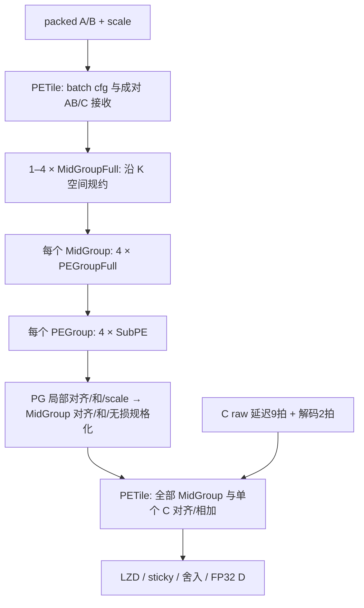

# Full 复用四层迁移与审查入口

> 历史Full迁移记录，当前基线见 [六种PE设计](six-pe-design.md)。本页证据不适用于新H/Q全局路径或新参数。

本轮按用户要求恢复 **SubPE → PEGroupFull → MidGroupFull → PETile** 四个实际 Module 层级，先迁移 full 复用实现、统一风格并写清 spec，再讨论简化微架构。当前基线在 `hw/chisel_src/`，package 为 `dp.*`。按用户追加要求，full 是一等且唯一的 Chisel 实现，已移除 reuse 隔离目录、旧扁平源码及其逐文件 spec/配置；历史内容保留在 Git。

来源为 `Quant_LLM_Chip_Codesign/HW/PE`，固定 commit `0ddc5f7c21082dbce73d992a4d33a5a331f1e0bc`，读取时该目录无未提交变更。原仓库只读；源文件 SHA-256 和目标映射见 [full-reuse-source.json](https://github.com/Futuresxy/DP-Puzzel/blob/6522618cb78dac9bc2f64c11e00365e730435b95/hw/spec/full-reuse-source.json)。没有迁入专用精度 variant、SystolicArray、旧 RTL、testbench 或 PPA 结果。

## 层级与资源复用



图中的多个 MidGroup 共同生成一个 D，是 K 方向空间规约；没有 M/N 阵列代码，也没有本地跨事务 accumulator。每个 SubPE 的四个部分乘法器随格式复用，Q/E 的末级局部加法复用；每个 PG 共享 scale 和局部对齐；每个 PETile 共享一次 C/D。资源复用不表示一条输入在这些层反复循环执行。

| 层 | 实例组织 | H/Q/E native K 容量 | 默认数值结果 | 相对输入 offer 的边界 |
| --- | --- | --- | --- | --- |
| [SubPE](https://github.com/Futuresxy/DP-Puzzel/blob/6522618cb78dac9bc2f64c11e00365e730435b95/hw/spec/pe/SubPE.md) | 4 个部分乘法器 | 1/2/4 | signed W29，各格式 F 不同 | 本模块 anchor1、data3；全局 S02/S04 |
| [PEGroupFull](https://github.com/Futuresxy/DP-Puzzel/blob/6522618cb78dac9bc2f64c11e00365e730435b95/hw/spec/pe/PEGroupFull.md) | 4 SubPE + 解包/scale | 4/8/16 | signed W33 + raw anchor | anchor S06、data S07 |
| [MidGroupFull](https://github.com/Futuresxy/DP-Puzzel/blob/6522618cb78dac9bc2f64c11e00365e730435b95/hw/spec/core/MidGroupFull.md) | 4 PEGroup + 对齐/规格化 | 16/32/64 | sign + W41 magnitude + top anchor | S11 |
| [PETile](https://github.com/Futuresxy/DP-Puzzel/blob/6522618cb78dac9bc2f64c11e00365e730435b95/hw/spec/core/PETile.md) | 1–4 MidGroup + 一个 C/D | 16N/32N/64N | FP32 | S18 |

H/Q/E 为互斥模式，不能加总为同拍吞吐。精度合同是有限窗口 RTZ 点积加 C 后再做 FP32 舍入，不是无限精度 fused dot。

## 迁移中的明确调整

1. 保留 full 四层、部分乘法器连线、Q 高 lane nibble2、scale slot 分配、W29/W33/W40→W42 边界及 S01–S18 结构，不继续展平或调整流水。
2. package 按职责放入 config、common、pe、core；Module/Bundle 名统一 UpperCamelCase，端口与硬件数据 lower_snake_case，寄存器 `_q`。原 SubPEFull 改类名为 SubPE，抽象 IO 外壳不产生额外实例。每个具体 Module 单独同名 Scala 文件。
3. PETile 只构造完整 Full MidGroup，N=1..4。专用 BF16、FP8、FP4、Low 和两组 E-only 结构暂不进入本轮 full 配置。N=3 是非二次幂结构检查项。
4. 统一使用 `DesignConfig`/JSON 和 `Generate` 入口；只开放 mid_groups=1..4 和 align_width=40..64，每个 MidGroup 固定 H16Q32E64，不再保留旧 kind/pes 或专用精度配置。移除源 ParamEnv/PETileCatalog/环境变量电路选择。其余位宽是固定合同，并非新增调参旋钮。
5. 内部无实际停顿功能的 Decoupled 改为 Valid，去掉无效 ready；PETile 外部 cfg 和 AB/C 成对接收仍为真实握手，输出为 Valid。保留 batch cfg，到最后输出才允许下一模式；不能混用旧扁平方案的逐事务切模式合同。
6. 原 RoundPack 的 FuDian RoundingUnit 依赖替换为本地 [RoundIncrement](https://github.com/Futuresxy/DP-Puzzel/blob/6522618cb78dac9bc2f64c11e00365e730435b95/hw/spec/core/RoundIncrement.md)，只实现基础 increment/carry/overflow方向。该调整和全部迁移电路都需后续独立 SV 数值验收。
7. 增加非法模式/scale/舍入码断言，子模块的 Valid 输入遇到非法请求不能静默认为成功。固定 full SubPE 位宽，非法构造参数立即拒绝。

这些调整不构成已完成微架构优化或 PPA 改善结论。Full 和历史扁平实现的接口、lane布局、格式采样边界不同，不直接共用 driver 或通过记录。

## 可复现入口与检查范围

在 `hw/` 下使用固定 Mill0.11.8 / Scala2.13.12 / Chisel6.4.0 / firtool1.62.0：

```sh
mill -i pe.compile
mill -i pe.runMain dp.elaborate.Elaborate full-review
mill -i pe.runMain dp.elaborate.Elaborate config configs/full_h16q32e64.json
CHISEL_FIRTOOL_PATH=/path/to/firtool-1.62.0/bin mill -i pe.runMain dp.elaborate.Generate configs/full_h16q32e64.json "full reuse source review"
```

review（full-review 为同义入口）覆盖 N=1/2/3/4 和 W64，并拒绝 N0/N5、39/65位窗口、非整数、未知字段和旧 kind/pes schema。检查与导出共用顶层构造器；导出检查四层 module 名存在，manifest 映射全部12类具体模块及配置，files.f 使用相对路径。实际层级实例数量另由 [结构检查工具](https://github.com/Futuresxy/DP-Puzzel/blob/6522618cb78dac9bc2f64c11e00365e730435b95/scripts/check_full_reuse_export.py) 从选定 export 的 RTL 核对，命令与结果见 [检查记录](https://github.com/Futuresxy/DP-Puzzel/blob/6522618cb78dac9bc2f64c11e00365e730435b95/hw/spec/full-reuse-checks.md)。

导出保持 `generated / rtl_test=not_run / ppa_eligible=false`。CHIRRTL 与 split RTL 结构检查不执行 DUT，也不验证数值或协议时序。

## 后续 Chisel → RTL → test → DC → power

| 步骤 | 所需证据与当前状态 |
| --- | --- |
| spec/Chisel/参数 | 本轮迁移与逐文件 spec，等待用户源码/合同审查 |
| 唯一 RTL | 现有统一 Generate；每次独立 export ID、fingerprint、module mapping，不覆盖 |
| RTL test | 待完成独立数值 reference、SV driver/monitor/scoreboard，覆盖各层定点损失、全格式、batch握手和18级周期口径 |
| 验证门禁 | 待绑定同份 RTL hash 与 SV 通过证据，失败或 hash 变化阻止 PPA；不能手改 manifest 设 passed |
| DC/时序 | 验证后在挂载 EDA 环境执行；库/PVT/约束/许可证和工具版本待接入 |
| power | 同份经验证 RTL/netlist、真实 workload 活动与窗口、annotation coverage；当前未执行 |

尚需审核：full 基线的参数与batch合同、是否删除冗余格式字段、HiF4规范来源、各格式误差验收、后续简化位宽/流水的目标。此轮保留原资源组织，不提前把待讨论优化写进实现。
