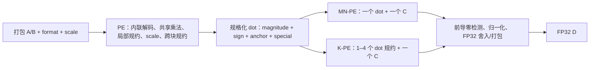

# PE 架构迁移与审查入口

> 历史扁平方案记录。本轮当前基线为 [full 四层复用迁移](full-reuse-migration.md)，此处接口与证据不适用于该基线。

来源为用户指定的 `Quant_LLM_Chip_Codesign/HW/PE`，源仓库 commit `0ddc5f7c21082dbce73d992a4d33a5a331f1e0bc`。读取时该目录无工作区修改；逐文件指纹见 [migration-source.json](https://github.com/Futuresxy/DP-Puzzel/blob/09b6657f26a0bf12aadc0051614db023a96850fa/hw/spec/migration-source.json)。原工程保留不动；当前代码是理解数值合同后重写，不保持原接口或文件层级兼容。

## 两层计算架构

图中 MN/K 为两种独立顶层选择，不同时连接同一个实例。`Accumulate`/`Normalize` 是内联电路生成函数，`Fp32Pack` 是基础算术模块；不是新增的计算组织层。

| 旧组织 | 新组织 | 保留的含义 |
| --- | --- | --- |
| SubPE | PE.scala 内 `sub_H…Q…E…` 区域 | 一个 16-bit 打包字的共享乘法/局部规约 |
| PEGroup | PE.scala 内 `group_H…Q…E…` 区域 | 四个字共享 scale，局部对齐/求和/scale 尾数乘法 |
| MidGroup | PE | 16 字或 E-only 8 字的完整带 scale 点积 |
| 单 MidGroup PETile | MNPE | 一个 PE 与 C 共同生成 FP32 D |
| 多 MidGroup PETile | KPE | 1–4 个 PE 共享 C/D 处理 |
| SystolicArray | 后续阵列阶段 | 当前未迁移；不混入本次 PE 审查 |

H = half，Q = quarter，E = eighth（不是 eighter）。它们是研究中的格式家族标签；Q 同时包含 FP8/FP6，不能按字母假定所有格式都严格占 FP32 的四分之一位数。

| 旧比例写法 | 当前 PE 名称 | H/Q/E 每次接收的实际元素数 |
| --- | --- | --- |
| H1Q2E4 | H16Q32E64 | 16 / 32 / 64 |
| H0Q2E0 | H0Q32E0 | 0 / 32 / 0 |
| H0Q0E4 | H0Q0E64 | 0 / 0 / 64 |
| H0Q0E2 | H0Q0E32 | 0 / 0 / 32 |
| H0Q2E4 | H0Q32E64 | 0 / 32 / 64 |

MN 顶层如 `MN_PE_H16Q32E64`，内部只有一个 PE。K 顶层合计对应家族容量，例如 `[H16Q32E64,H0Q0E32]` 为 `K_PE_H16Q32E96`；运行 H 时只使用第一个 PE，运行 E 时两者都参与一个 D 的规约。相同总容量可能有不同实现，后续 export config ID/manifest 必须记录完整有序布局及对齐位宽，不能只记录 top 名。

## 保留与修改

- 保留 16-bit packed word、H/Q/E 的共享部分乘法结构、逐组 scale、不同格式的固定点坐标、W40 跨块对齐、PE 11 拍和顶层 18 拍的基本调度。
- 移除多层 abstract shell、环境变量参数、family 字符串解析、重复类型/scale-type 字段、无实际反压的 ready 接口、batch 配置状态机。格式从每个事务采样，与数据同步，允许连续事务切换合法格式。
- Q 的两个 4-bit 解包尾数改为相邻 nibble，简化路由。原低精度 slot2 与 sign1 的特殊对应消失。
- E-only 保留 W11 字规约、同 anchor 预加、单个小移位器、W22 scale 后数据，避免使用 Full 的 W29/W33 路径。
- MAX 用一个交换将获胜通道移到旁路，其他 N−1 通道移位；CSA 按层压缩，避免串行压缩链。
- FP32 舍入重写为本项目基础模块，不复制 FuDian/HardFloat 依赖。未来数值验证需专门覆盖其边界。
- 不宣称 PPA 改善：裁剪和共享是结构选择，面积、时序、动态功耗仍需经验证 RTL 和 EDA 测量。

## 数值边界与尚待验收

当前合同为有限位宽点积：Q 字内、组内、跨组和 dot+C 存在明确 RTZ 对齐。PE 规格化无损，但不能恢复前面丢失的低位；D 的 RNE 等模式只对已形成的有限窗口结果舍入，不能宣称等价于无限精度 FMA/正确舍入点积。以后 SV golden 必须同时验证硬件数值合同与相对高精度参考的误差，特别是严重抵消和大指数差。

MX/NV/HiF4 的块与 scale 语义见 [Decode](https://github.com/Futuresxy/DP-Puzzel/blob/09b6657f26a0bf12aadc0051614db023a96850fa/hw/spec/common/Decode.md)。HiF4 暂保留源工程实验性编码，不宣称符合外部标准。NVFP4 此接口只处理 block scale，张量级额外 scale 的施加位置属于上游/下游合同，未隐式增加 FP32 全局乘法器。

本轮完成源码、Scala 编译/CHIRRTL 结构展开，并按用户追加要求提供 [集中参数](https://github.com/Futuresxy/DP-Puzzel/blob/09b6657f26a0bf12aadc0051614db023a96850fa/hw/spec/config/Parameters.md)、[JSON 配置](https://github.com/Futuresxy/DP-Puzzel/blob/09b6657f26a0bf12aadc0051614db023a96850fa/hw/spec/../configs/README.md) 及 [唯一 RTL 导出入口](https://github.com/Futuresxy/DP-Puzzel/blob/09b6657f26a0bf12aadc0051614db023a96850fa/hw/spec/elaborate/Generate.md)。参数导出检查只生成未验证 RTL，用户代码审查后再完成独立参考模型与 SV 精度/周期 testbench；没有测试通过的 RTL，不允许进入 DC/power 或发布 characterization。旧工程的验证/PPA 证据不能自动继承。

本轮具体检查及导出指纹见 [migration-checks.md](https://github.com/Futuresxy/DP-Puzzel/blob/09b6657f26a0bf12aadc0051614db023a96850fa/hw/spec/migration-checks.md)。
