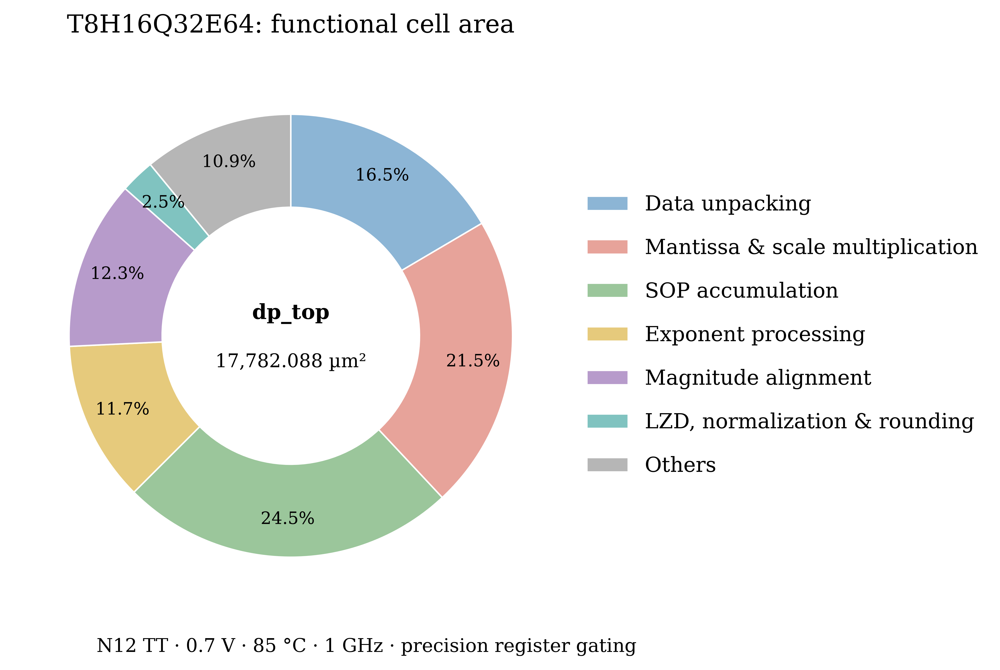
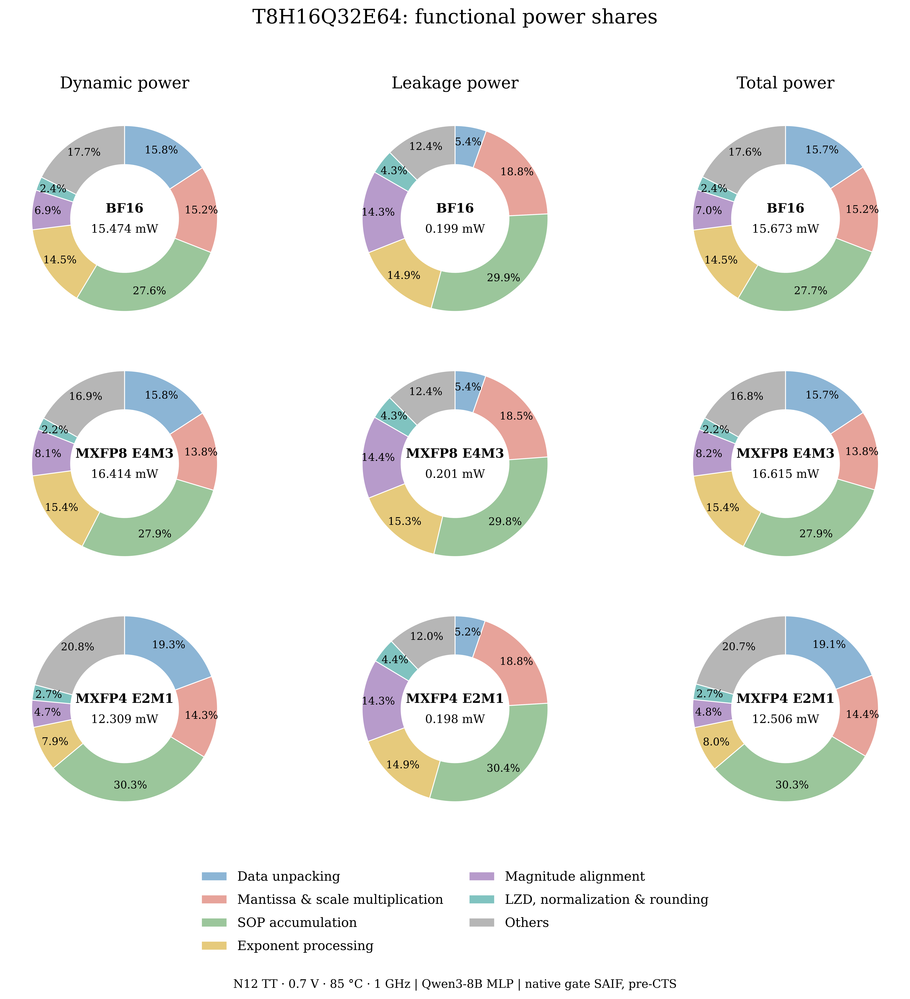

# dp_top 七类功能面积与功耗

2026-11-09（Asia/Shanghai）。采用用户确认的七类口径，复用已验收的
`dc_dp_top_11081432` / `DP_verilog_a32ed7ef4b093ffa`。
本次只重新归集既有物理单元和功耗报告，没有修改 RTL、重新综合或重新测量活动。

## 面积结果

单位 µm²；组合、寄存器和 ICG 分开统计，百分比的分母为全部叶单元面积之和。

| 功能 | 组合逻辑 | 寄存器 | ICG | 总面积 | 占比 |
|---|---:|---:|---:|---:|---:|
| 数据解包 | 2204.615 | 733.557 | 0 | 2938.171 | 16.52% |
| 尾数及 scale 乘法 | 3100.004 | 724.931 | 0 | 3824.935 | 21.51% |
| SOP 累加，含符号化 | 3362.513 | 989.430 | 0 | 4351.943 | 24.47% |
| 指数处理 | 1380.483 | 704.655 | 0 | 2085.138 | 11.73% |
| 移位对齐，含取幅值 | 2189.943 | 3.871 | 0 | 2193.814 | 12.34% |
| LZD、规格化、舍入 | 405.172 | 39.813 | 0 | 444.985 | 2.50% |
| Others | 1459.556 | 396.251 | 87.294 | 1943.101 | 10.93% |
| **总计** | **14102.286** | **3592.507** | **87.294** | **17782.088** | **100%** |

CSV 保留未四舍五入的数值，表格逐项舍入后可能有尾差。



## 归属边界

| 类别 | 当前归集规则 |
|---|---|
| 数据解包 | 字段提取、格式选择、隐含位、特殊值分类、FP4 系数解码、紧凑存储；解码器内与其他输出共用的指数逻辑仍留在此类 |
| 尾数及 scale 乘法 | 元素尾数乘法及内部部分积规约/重构、scale 系数乘法、group scale 乘法、乘积及相关流水；S5 幅值寄存器同时承载乘法/旁路结果 |
| SOP 累加 | 幅值恢复为有符号补码、E pair 求和、lane/group/final+C 规约树、保存有符号累加操作数/结果的寄存器 |
| 指数处理 | 元素/scale 指数加法、有效指数重编码、MAX、group `A_raw` 修正、全局 `A_raw-z`、相应指数寄存器 |
| 移位对齐 | 有符号数取绝对值、局部指数差、全局净移位量、RTZ/双向移位核、分离幅值后的符号旁带；最后累加结果取幅值也归此类 |
| LZD、规格化、舍入 | group/C/最终前导检测、规格化、舍入及由此产生的指数修正、FP32 编码、INT 输出转换与输出寄存器 |
| Others | 数据选择/旁路、控制/特殊值、ICG、原始 C 搬运、无法可靠分离的共享组合逻辑 |

寄存器按其保存的数据归属，不按源文件名归属。因此移位后的**有符号累加操作数**
寄存器计入 SOP，对齐类的寄存器面积很小，不代表移位前后没有流水寄存器。
乘法内部部分积树仍属于乘法器；E pair 以及乘积间的规约树属于 SOP。

解码器仅服务于有效指数输出的逻辑锥转入指数处理。这部分包含字段路由、非规格化数
指数处理、Q 类偏置变换和输出屏蔽，**不能当作单独的 bias 加法器面积**。
同时服务于分类/幅值等输出的共享门保持解包归属，没有按比例拆分。

## 相对上一版八类的变化

完整转移矩阵见 [transfers CSV](current_dp_top_area_seven_transfers.csv)。主要变化为：

- 符号转换中的 2494.476 µm² 并入 SOP，55.923 µm² 并入移位对齐。
- 解包中的有效指数专用组合逻辑 173.335 µm²、S1 指数寄存器 212.337 µm²
  转入指数处理；恢复出的 INT8 取幅值逻辑 190.513 µm² 转入移位对齐。
  解包从 3514.356 降至 2938.171 µm²，完全是分类变化。
- 局部 delta 443.990 µm² 和全局净移位量 83.755 µm² 转入移位对齐；
  全局 `A_raw-z` 46.707 µm² 保持指数处理；两者共享的 0.516 µm² 归 Others。

每个物理叶单元只归一类。82,502 个单元完整覆盖，无重复、无遗漏。
总面积为 17782.087680 µm²，与 DC 总报告 17782.087803 µm² 的差
0.000123 µm² 来自打印精度。此前对 1,063 个层级的独立核对见
[面积审计](current_dp_top_area_audit.md)。

新一轮检查覆盖 128 个元素解码器，对恢复出的 INT8 幅值边界新增 160 位 SAT
等价证明，配合已有 pair/补码边界证据使用。恢复不完整的融合逻辑保持原有归属：
Others 中仍有 552.002 µm² 混合对齐逻辑和 738.828 µm² 内联共享/未分离逻辑。
group/C 的取幅值逻辑也未全部恢复为独立边界。因此这些是可追踪的功能归集，
不是每个数学算子可被独立替换后节省的精确面积；Others 不能全部解释为纯控制开销。

## 同口径功耗

直接按相同的逐单元归属重加既有 BF16、MXFP8 E4M3、MXFP4 E2M1 功耗，
没有更换网表、SAIF 或活动窗口。下表是各自**动态功耗**的占比：

| 功能 | BF16 | MXFP8 E4M3 | MXFP4 E2M1 |
|---|---:|---:|---:|
| 数据解包 | 15.80% | 15.85% | 19.34% |
| 尾数及 scale 乘法 | 15.16% | 13.78% | 14.32% |
| SOP 累加 | 27.63% | 27.92% | 30.28% |
| 指数处理 | 14.47% | 15.36% | 7.85% |
| 移位对齐 | 6.89% | 8.09% | 4.70% |
| LZD、规格化、舍入 | 2.39% | 2.16% | 2.68% |
| Others | 17.66% | 16.85% | 20.83% |
| 动态功耗合计（mW） | 15.473720 | 16.413597 | 12.308738 |
| 漏电功耗合计（mW） | 0.199030 | 0.200999 | 0.197723 |
| 总功耗（mW） | 15.672749 | 16.614595 | 12.506461 |

面积与三种负载下的功耗总量均与上一版逐单元汇总一致。所有动态、漏电、总功耗
分项和占比见 [功耗 CSV](current_dp_top_power_seven.csv)。库寄存器时钟引脚内部
功耗计回所属功能类，ICG 归 Others；每个单元的驱动网络 switching 已包含，不再重复加网功耗。

条件为 N12 TT、0.7 V、85 °C、1 GHz，Qwen3-8B MLP 真实负载，VCS native gate SAIF、
512 ns 窗口。结果为综合后、布局布线前估计，未包含 CTS/SPEF/SDF 的物理实现开销。
逐叶加和与原 Power Compiler 总报告的打印差见既有 reconciliation CSV，不做比例修正。



## 后续优化优先级

1. **先审查 SOP 的位宽和符号处理。** 占 24.47%，其中组合逻辑 3362.513 µm²，
   寄存器 989.430 µm²。已分出的局部/全局补码恢复约 1152.774 µm²，
   E pair 符号准备 500.281 µm²，lane 规约树 1002.406 µm²。
   优先检查逐精度有效位宽、符号扩展和补码转换能否与累加结构合并；不能直接删除
   负数处理，也不能未经数值证明缩短位宽。SOP 同时是三种负载的最大动态功耗类。
2. **再看元素乘法 bank 与解包。** 元素乘法 bank 组合面积 2679.570 µm²（15.07%），
   需要检查部分积生成/重构、格式选择和寄存器存储是否重复。解包剩余 16.52%，
   其中寄存器 733.557 µm²；先区分必要紧凑存储与可化简的格式解码，评估固定字段
   提取替代通用解码表达式的实际综合收益。不能仅凭 RTL 声明宽度推断硬件面积。
3. **移位器有针对性处理。** 独立移位核 1419.633 µm²（7.98%），局部 delta
   443.990 µm²（2.50%）；当前证据不支持把大部分面积都归因于移位器。
   剩余共享逻辑还需先明确边界，再选择优化点。

以上是下一轮候选顺序，本轮不改 RTL。任何优化收益需在同库/约束下以数值验证、
L8/II=1 与 1 GHz 时序、面积和真实活动功耗的对照实验确认。

## 数据与复现

- [面积 CSV](current_dp_top_area_seven.csv)、[功能明细](current_dp_top_area_seven_detail.csv)
- [功耗 CSV](current_dp_top_power_seven.csv)、[来源和校验和](current_dp_top_area_seven_sources.json)
- 本地逐单元表/解码器覆盖/边界证明：`hw/power/runs/dp_top_seven_1109_0015/`。
  原始库函数及大报告仅本地保留，原报告未覆盖。

```bash
# 需 z3-solver；已有证据链是输入，新 run 目录必须不存在。
python3.11 hw/power/scripts/classify_seven_functional.py \
  --run hw/power/runs/<new-report-id>

# 需 matplotlib；保留旧图，生成带 _seven 后缀的新图。
python3.11 paper/data/H16Q32E64_area/plot_area.py --seven
```
