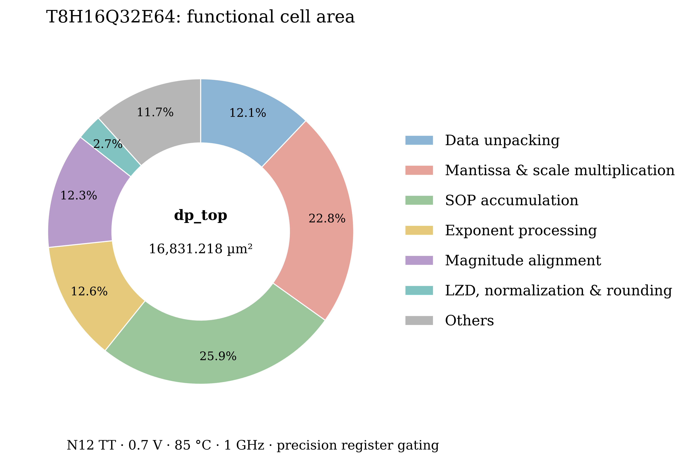

# 固定解包版 dp_top：七类功能面积

2026-11-09（Asia/Shanghai）。对应代码提交 `3635edd`、export
`DP_verilog_ce47b3d5b06c0eca`、DC run `dc_dp_top_11090056`。
N12 TT/0.7V/85°C、1GHz、K16/28/40、L8/II=1，精度寄存器门控及 ICG 开启，
原综合 setup/hold、电气规则和 VT 配额均通过。

本次只读恢复已验收 DDC，导出逐叶单元面积及本地库逻辑函数，再对新网表重新识别
功能边界。没有重新综合，没有把旧 SAIF 或旧功耗数据套到新网表。

## 当前结果

| 功能类别 | 组合逻辑 µm² | 寄存器 µm² | ICG µm² | 总面积 µm² | 占比 |
|---|---:|---:|---:|---:|---:|
| 数据解包 | 1340.854 | 690.684 | 0.000 | 2031.538 | 12.07% |
| 尾数及 scale 乘法 | 3112.206 | 725.262 | 0.000 | 3837.469 | 22.80% |
| SOP 累加，含符号化 | 3365.204 | 990.683 | 0.000 | 4355.887 | 25.88% |
| 指数处理 | 1417.089 | 701.338 | 0.000 | 2118.427 | 12.59% |
| 移位对齐，含取幅值 | 2061.730 | 3.428 | 0.000 | 2065.158 | 12.27% |
| LZD、规格化、舍入 | 417.006 | 42.541 | 0.000 | 459.547 | 2.73% |
| Others | 1479.131 | 396.767 | 87.294 | 1963.192 | 11.66% |
| **总计** | **13193.220** | **3550.704** | **87.294** | **16831.218** | **100%** |



总量来自 76,947 个唯一物理叶单元，含 5,319 个 DFF 和 148 个 ICG。
寄存器跟随所保存数据的功能归属，因此该表不同于 [实际 module 面积表](fixed_unpack_module_area.md)。
例如 lane 本层的 S3/S6 有符号操作数寄存器计入 SOP；解包模块内的有效指数寄存器计入指数处理。

## 七类边界

| 类别 | 归属 |
|---|---|
| 数据解包 | 固定字段提取、格式选择、hidden bit、原编码分类、FP4 系数转换、相应紧凑存储；无法独立分开的共享解码仍保留其解包归属 |
| 尾数及 scale 乘法 | 元素乘法及内部部分积规约/重构、scale 系数乘法、group 幅值乘 scale、乘积寄存器及 S5 幅值保存 |
| SOP 累加 | 幅值恢复补码、E pair、lane/group/final+C 规约、有符号累加操作数及结果寄存器 |
| 指数处理 | 指数加法/偏置重编码、MAX、A_raw、A_raw−LZD、有效指数及 anchor 寄存器 |
| 移位对齐 | 已识别的取幅值、局部 delta、全局净移位量、RTZ/双向移位、分离幅值的符号旁带 |
| LZD、规格化、舍入 | group/C/最终 LZD、规格化与舍入引起的指数修正、FP32 编码/INT 输出转换、输出寄存器 |
| Others | 控制/特殊摘要、选择/旁路、原始 C 搬运、ICG，以及算术边界无法可靠拆开的混合逻辑 |

补码恢复归 SOP，取幅值归对齐；MAX/anchor 归指数，移位差值归对齐。
乘法内部部分积树归乘法，乘积之间的 pair/规约归 SOP。没有重复计算父模块或其子单元。

## 新解包的边界处理与限制

- 对 32 份 A/B atom 分别追踪输出依赖。仅服务于有效指数的逻辑锥
  **216.871 µm²** 归指数处理；它含指数输出选择/屏蔽，不能当作纯 bias 加法器成本。
- 新映射将 INT8 取幅值与格式选择融合，未恢复出完整独立的 gated-abs 中间节点。
  补充按各合法 datatype 做布尔常量传播：仅在 INT8 下参与幅值输出、且不服务于
  其他格式/指数/符号/分类输出的 **496 个单元、63.701 µm²** 归移位对齐，
  明细标作 `INT8-exclusive magnitude logic (abs and dedicated routing)`。
  这是分析网表依赖，**没有给 DC 增加 datatype case analysis**。
- 与其他格式或分类共用的门继续归共享解码，不能把 63.701 µm² 解释成整个 INT8
  取幅值功能的独立面积。旧版节点保留方式不同，因此七类之间的变化同时受到
  真实重新映射和可分离边界的影响，不能把某一类的差值全部解释成纯算子节省。
- E pair、global bypass、最终 abs 等边界重新进行节点匹配和 SAT 核验；本次累计
  **1475 位等价证明**。未恢复完整的融合逻辑不按比例分摊。
- Others 中仍有 **552.665 µm²** 混合对齐逻辑和 **763.564 µm²** 内联共享/未分离
  逻辑，不能把整个 Others 解释成纯控制器面积。group/C 的取幅值边界也未全部独立恢复。

因此，表格是有可追踪边界和已说明限制的功能归集，不是每种数学算子独立替换后的
精确可节省面积。全 DP 面积和同 module 边界的变化更适合确认优化的净收益。

## 与优化前比较

旧七类表对应 `dc_dp_top_11081432`，完整对照见
[分类比较 CSV](fixed_unpack_area_seven_comparison.csv)。数据解包归集面积从
2938.171 降至 **2031.538 µm²**，占比从16.52%降到 **12.07%**。
全 DP 总面积减少 **950.870 µm²（5.35%）**，是同条件综合的实际净收益。
同一解包 module 边界的减少29.39%另见 [优化对照](../../../hw/dc_syn/records/fixed_unpack_20261109.md)。

SOP 从4351.943变为4355.887 µm²，乘法从3824.935变为3837.469 µm²，绝对面积变化很小；
它们占比升高主要因为 DP 总面积缩小。两者合计 **48.68%**，是下一轮优化主要关注对象。

## 核验与文件

逐单元之和 **16831.217664 µm²**，正式 DC 总值 **16831.217776 µm²**，差
0.000112 µm² 为打印精度。全部967个层级均与叶单元独立加和核对，最大误差
0.000136 µm²；各单元只归一类，类别/组成面积守恒，不把尾差比例分配。

- [面积 CSV](fixed_unpack_area_seven.csv)、[子功能明细](fixed_unpack_area_seven_detail.csv)
- [来源、网表及脚本校验和](fixed_unpack_area_seven_sources.json)
- 本地原始报告、逐单元归属、SAT 证明和层级核对位于
  `hw/dc_syn/runs/dc_dp_top_11090056/analysis/functional_20261108T235702732125Z/`。
  商业库函数和大报告不提交 Git。
- 复用的逻辑锥提取函数在旧网表上重放，82502个旧叶单元归属全部保持一致；
  专用常量传播测试覆盖选择、共享和屏蔽路径。

```bash
# 需本机 EDA 环境；只读导出，输出一个新的 analysis 目录。
python3.11 hw/dc_syn/scripts/export_functional_area.py --run-id dc_dp_top_11090056
# 需 z3-solver；使用上一命令打印的目录。
python3.11 hw/power/scripts/classify_fixed_unpack_area.py --report <analysis-directory>
# 需 matplotlib；只绘新面积，不生成没有测量依据的新功耗图。
python3.11 paper/data/H16Q32E64_area/plot_area.py --fixed-seven
```
