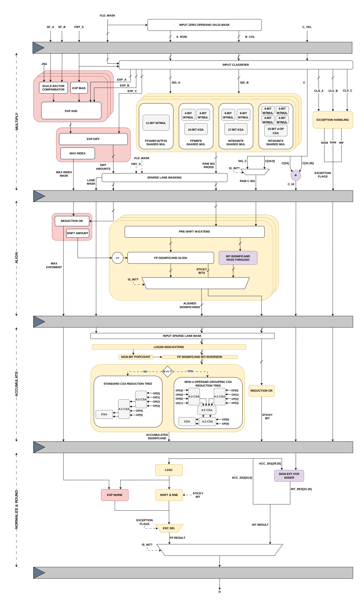

## III. TEN-FOUR 微架构

Ten-Four 是一个开源的融合点积硬件 IP 1，用于开发功能丰富的混合精度 GPGPU 张量核心，采用 SystemVerilog 编写。

## A. 关键算术子模块

混合精度融合内积点积数据通路需要若干多操作数加法。进位保存加法器（CSA）尤其适合该任务，因为它能够在无进位传播依赖的情况下，将 N 个各为 W 位的操作数有效规约为一个 $( \mathbf { W } + \mathrm { l o g _ { 2 } N } ) – \mathbf { b i t }$ 的和与进位。我们开发了一种标准 CSA：使用递归级联的 4:2 压缩器，并在操作数个数为奇数时使用条件 3:2 压缩器；同时还开发了基于 MOD-4 操作数分组的 CSA，以在需要累加七个或更多操作数时进一步最小化关键路径。最终求和由 Kogge-Stone Adder（KSA）完成；该结构通过其并行前缀树在每一级实现更低扇出，以牺牲面积效率为代价，相比超前进位设计可获得更低延迟。我们还实现了 Wallace 树乘法器（WTMUL），其部分积可借助 CSA 高效规约。我们决定不在设计中引入 Radix-4 Booth 重编码，因为在目标 4-11 位宽下，由位对编码带来的额外开销超过了部分积数量减半的收益。

## B. Ten-Four 混合精度浮点数据通路

根据 SIMT 子核心配置，Ten-Four 分别在 4/8 或 16/32 线程/warp 下执行四元素或八元素 FEDP。它还可以在编译时配置为选择性实例化可用输入格式中的任意子集或全部，以便根据应用需求减少面积并提升效率。例如，仅使用 FP16/BF16/TF32 格式的 LLM 训练工作负载，可以通过完全省略低精度格式逻辑而获益。Ten-Four 也显然支持在运行时通过源格式信号动态选择输入数据类型。如图 2 所示，完整的 Ten-Four 数据通路由 4 个流水级组成：

1) Stage-1：共享乘法器、差分矩阵与异常处理：Ten-Four 在尾数位宽相近的格式之间采用按类别共享乘法器方案，在格式专用乘法器的短关键路径与 Zhang 等人提出的统一子字部分积阵列面积效率之间做出了等权衡 [31]。例如，FP16、BF16 和 TF32 三者的尾数乘法都在一个 11×11 位 WTMUL 中完成。相应地，BF16 尾数在进入乘法器前需要做零扩展以保持相同位宽。请注意，由于输入以每个 32 位寄存器打包为 FP16/BF16 对或 FP8/BF8 四元组，对于给定的 K 元素点积，我们并行实例化 2×K 条乘法通道。由于按这种方式每个 32 位寄存器只能打包一个 TF32 操作数，因此该输入类型只有隔一条通道有效。相反，由于可将四个 FP8/BF8 元素打包在一起，它们需要额外一次归约，以在流水线后续阶段保持操作数计数一致。因此，FP8（E4M3）和 BF8（E5M2）共享两个 4×4 位 WTMUL，其乘积随后通过一个 24 位 KSA 求和。以这种方式，所有格式都收敛为原始 E8M25 中间表示，以在后续流水级中保持一致性并实现高效资源利用。

  
图 2. Ten-Four 融合点积微架构

类似地，输入 A 和 B 操作数的指数和及其各自按格式到 FP32 的偏置转换，按以下方程计算：

$$
C O N V _ {F P 1 6 / F P 3 2} = B I A S _ {F P 3 2} - (2 \times B I A S _ {F P 1 6}) + 1\tag{2}
$$

$$
E X P _ {F P 3 2} = E X P _ {A} + E X P _ {B} + C O N V _ {F P 1 6 / F P 3 2}\tag{3}
$$

这些指数和被送入我们最大指数识别电路的第一部分，该电路将 Sohn 等人的基于减法器比较器架构 [30] 扩展为支持任意数量 N 的操作数。首先，并行计算所有 $( N - 1 ) \times ( N - 1 )$ 两两指数差，形成差分矩阵。每个减法器结果的符号位表明其操作数对的相对大小。为降低面积开销，我们利用对称性，仅计算上三角，并通过对符号位取补来导出下三角。随后，通过归约 AND 与 NOR 逻辑从符号矩阵中提取最大指数索引，并以 one-hot 编码掩码形式传递到下一阶段。

此外，与指数和尾数处理并行地执行标准 IEEE-754 兼容异常处理。对于每个乘积，我们检测 NaN 输入与无穷大乘零条件以捕获乘法异常。加法异常则通过在点积元素与加数之间识别符号相反的无穷大来检测，从而预先生成结果的符号、NaN 和无穷大标志。

2) Stage-2：最大指数、移位量与有效数对齐：该阶段通过对前一阶段 one-hot 编码掩码做归约 OR，完成最大指数识别。随后复用差分矩阵并在需要时对数值取负来导出移位量，与传统归约树比较器相比，以 $O ( N ^ { 2 } )$ 的面积代价获得近似 $O(1)$ 的关键路径复杂度（在较大 N 时实践中受扇出限制）。最后，使用计算出的移位量对有效数乘积进行对齐，并保留两个额外对齐位以及每条通道由移出位产生的 sticky 位以保持精度。

3) Stage-3：累加：朴素点积实现会在点积求和后再单独累加加数“C”，这需要额外的二操作数对齐、规格化和舍入，从而同时增加舍入误差和关键路径延迟。我们的设计从第一个流水级就集成了加数处理，其中 C 的指数参与最大指数查找，其有效数与乘积项一起进行对齐。

在这里，对齐后的有效数和加数首先符号扩展到 $2 5 { + } \log _ { 2 } ( 2 K )$ ) 位，以正确处理有符号算术。现在，我们不再在多操作数 CSA 之前对每个负项分别进行朴素的 2 的补码，而是仅对负有效数做按位取反，并将 +1 校正延后为在 CSA 中作为额外操作数统一处理，其数值就是累加中负项总数。该值通过对每条通道的符号位执行 popcount 计算得到。根据操作数总数——在 4/8 线程/warp 下为 6 个（K 个乘积、1 个加数、1 个校正项），或在 16/32 线程/warp 配置下为 10 个——在编译时选择标准 CSA 树或 MOD-4 操作数组分 CSA。同时，每通道 sticky 位也被归约 OR 成单个 sticky 位，用于对最终 FEDP 结果舍入。

4) Stage-4：规格化与舍入：最终流水级从有符号累加结果中提取幅值，并利用预测型前导零计数器（LZAC）确定规格化移位量。通过从最大指数中减去计算出的移位量来调整指数，同时通过将有效数左移来规格化尾数。使用 LSB、Guard、Round 以及先前提取的 Sticky 位应用标准最接近偶数舍入（RNE），生成最终 FP32 点积结果。若发生异常，则结果会被 IEEE 兼容的规范 NaN 或无穷大表示覆盖。

## C. 融合整数数据通路

整数点积运算需要浮点数据通路中已存在的多个算术组件 [26, 32]。融合两条流水线可消除仲裁器需求，并避免调度两个独立 Tensor Core 执行单元。因此，Ten-Four 也尝试做到这一点：在现有浮点数据通路内支持 INT8、UINT8、INT4 和 UINT4 乘法以及 INT32 累加，仅增加最小的多路复用开销。虽然整数格式拥有其各自按类别共享的乘法器，并且会直接穿过 stage 2，但代价显著更高的 stage 3 累加器同样可被整数格式复用。

然而，融合 32 位整数加数 C 的加法存在挑战，因为它超出了累加器宽度 $2 5 { + } \log _ { 2 } ( 2 \mathrm { K } )$ 位。我们采用一种新颖的拆分策略来解决这一约束。C 的低 25 位与乘积项一起在 stage 3 的 CSA 中累加，而仅高 7 位（在图 2 中记为 C HI）沿流水线传播，从而显著降低中间流水寄存器开销。在最终阶段，整数结果的高 7 位在与浮点规格化并行的过程中构建，方法是将来自累加器的符号扩展溢出与 C HI 相加。随后将其与低 25 位累加结果直接拼接，产生完整的 INT32 输出。