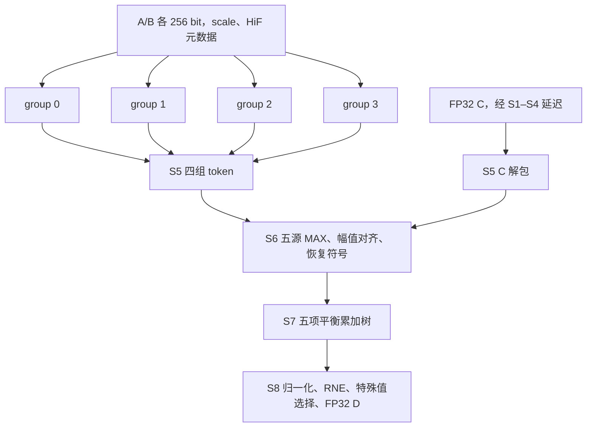

> 功能：四组低精度独立 DP 装配；范围：E64、Q32E64 顶层与共用五源后端；版本：v1.7.7；修改时间：2026-11-08 09:41:42 +0800；对应代码：src/verilog/top/common/dp_top_lowp.v、dp_top_e64.v、dp_top_q32e64.v（已实现），src/cmodel/lib/json_io.cpp、现有 E/QE group 与 top/backend.cpp；Chisel 未实现。

# 四组低精度 DP

保留已验证的 E/QE group 微架构，仅增加固定四组的独立装配，不含多精度基础组或 T/H/INT8 通路。现有 dp_top_e 继续作为参数化历史入口保留。新顶层以 dp_top_lowp 共用后端与控制，静态选择 group 种类，不生成运行时前端选择器。

| 顶层 | 前端实例 | 每 lane / group 容量 | 一笔原生 K | 模式 |
| --- | --- | --- | --- | --- |
| dp_top_e64 | 4×dp_group_e | E8 / E16 | E64 | MXFP4、NVFP4、HiF4 |
| dp_top_q32e64 | 4×dp_group_qe(COMPACT_UNPACK=1) | Q4E8 / Q8E16 | Q32 / E64 | MXFP8 E4M3/E5M2、MXFP6 E2M3/E3M2，以及三种 E |

## 顶层组织

每组消费 A/B 的 `[64*g +: 64]`，组内两个32-bit lane。Q 在字节槽存储（FP6 不跨字节压紧），E 按 nibble；每组 scale 一个字节，HiF e1 四位/e2 两位。scale 的跨组广播遵循 [layout-and-scales](layout-and-scales.md)，不改变数学缩放粒度。C 仅加一次。

所有四组同步接收同一个 req_fire。A/B 类型相同且属于该顶层支持集合、scale 类型匹配、C 为 FP32、三路 valid 且 rst_n=1 时共同 ready。非法类型拒收并注入气泡，不钳位功能输入。无扩展分支参与掩码，没有高精度旁路；零值/特殊值在共用对齐模块中正确排除或归约。保持逐请求切换模式、L8/II=1、同步低有效 rst_n、无输出反压。

## 流水与数值边界

| 级 | E64 前端 | Q32E64 前端 | 顶层 |
| --- | --- | --- | --- |
| S1 | E 窄解包 | 紧凑 QE M/E/sign/class 解包 | C raw 与控制寄存 |
| S2 | 4×4 乘法及第一层 pair | 乘积/指数公共 MAX | C raw 延迟 |
| S3 | 四项 pair 规约 | Q 局部对齐 / E pair | C raw 延迟 |
| S4 | 两 lane 组和及符号分离 | lane 规约 | C raw 延迟 |
| S5 | NV/HiF 14×8 无符号 scale、LZD | 两 lane 合并、abs、scale、LZD | C 解包，同拍形成五源 |
| S6 | 共用后端 | 共用后端 | 五源 MAX/移位/补码恢复 |
| S7 | 共用后端 | 共用后端 | 五项求和，完整保留增长位 |
| S8 | 共用后端 | 共用后端 | 唯一 FP32 RNE 与特殊结果编码 |

K_FP16 固定16，仅为兼容规模索引，不代表支持 FP16。LOCAL_W≥27、GLOBAL_W 使幅值窗口容纳组 token 和 C；默认28/40，可测试27/40与32/64。组幅值 M=LOCAL_W+3，C幅值32，补零到 GLOBAL_W−1；符号、anchor、z 与特殊摘要独立传递。E 与 QE 的 HiF4 内部坐标可以不同，**不得强行复用数值 anchor 常量**；S6 使用 token 的 A_raw−z 比较、A_raw−E_max 求净移位，不再按类型二次调整 F。

| 位置/精度 | S | I | F | 默认总宽 |
| --- | --- | --- | --- | --- |
| S6 MXFP8/6（QE） | 1 | 1 | GLOBAL_W−2 | 40 |
| S6 MXFP4/NVFP4/HiF4 | 1 | 1 | GLOBAL_W−2 | 40 |
| S7 MXFP8/6（QE） | 1 | 4 | GLOBAL_W−2 | 43 |
| S7 MXFP4/NVFP4/HiF4 | 1 | 4 | GLOBAL_W−2 | 43 |

S5 格式沿用 [E group](../group/dp_group_E.md) / [QE group](../group/dp_group_qe.md)，不修改 group 内计算和寄存器。S7宽 GLOBAL_W+ceil(log2(5))；S8 输出为FP32编码。

## 模型、验证与面积比较

CModel 配置 e64→E、q32e64→QE，复用已实现逐级数值路径及共同后端；固定容量配置拒绝非K16或L9。配置文件为 src/configs/dp/{e64,q32e64}_top.json。不复制第二套数值算法；S1紧凑字段由既有QE解包等价测试覆盖，顶层验证比较S5/S6/S7及最终结果。

独立 files_e64.f/files_q32e64.f、独立快照与完整回执。各支持格式961笔数学golden和CModel比对；E定向覆盖、随机/非法类型、连续请求/气泡/复位、三个窗口参数。通过门禁后以 N12 TT 0.7V 85°C、1GHz、ICG开启、时序优先的同工况综合；检查setup/hold/电气/VT，报告完整面积和前端/后端分解。不得用四个group面积代替完整DP面积。当前状态：CModel、Verilator 与 N12 TT/1GHz DC 均完成，L8/II=1 未改变。

## 本批验收

CModel 检查点 `2db339d`，RTL/Verilator 检查点 `4045e00`。E64 三种格式各961笔与数学参考完全一致；Q32E64 七种格式各961笔，最大1 ULP；三组窗口、S5–S7和原子接收/复位协议通过，见 [功能回执](../../../../test/results/lowp-tops-v1.7.4.md)。

同工况 DC：E64 5644.14 µm²，Q32E64 11542.08 µm²，相对多精度基线16929.31 µm²分别减少66.66%/31.82%。setup/hold、VT≤20%和电气门禁通过；ICG实测覆盖97.34%/98.49%。这是指定TT角的预布局综合，最差setup仅0.022531/0.017643 ps，不能作为布线后裕量或工作负载功耗结论。详见 [面积/逐级时序对比](../../../../hw/dc_syn/records/README.md#历史记录)。

首轮完整综合面积/时序已通过，但逐级报告白名单遗漏新顶层名称；修正报告入口后用同一RTL、库和约束独立重跑，面积一致。最终run为 dc_dp_top_e64_11080854 / dc_dp_top_q32e64_11080855，未增加流水或进行额外时序修复。
