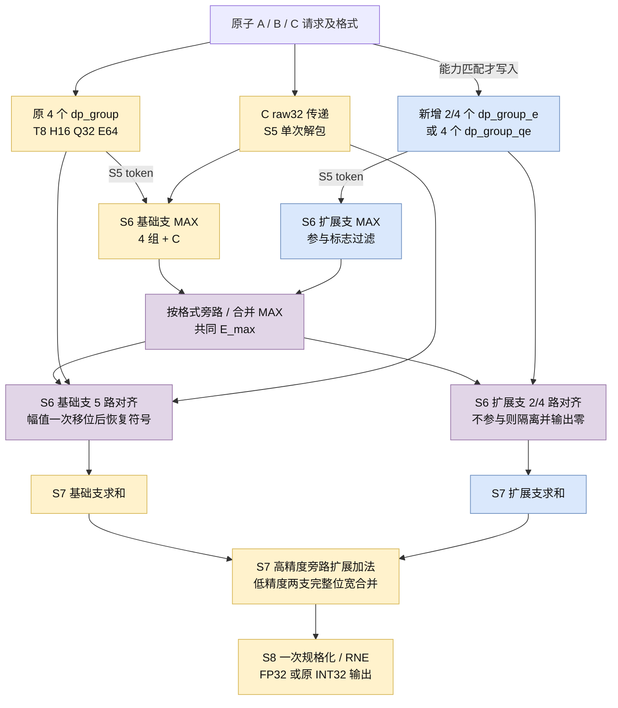

> 功能：定义在 T8H16Q32E64 上扩展 E/Q 算力的顶层；范围：E96、E128、优化 Q64E128、分支屏蔽、全局对齐及 L8；版本：v1.7.6；修改时间：2026-11-08 09:27:17 +0800；对应代码：[混合 CModel](../../../cmodel/lib/top/mixed.cpp) 已实现；[dp_top_mixed.v](../../../verilog/top/common/dp_top_mixed.v) 与三个现用固定配比顶层已实现；现有入口为 [dp_top.v](../../../verilog/top/dp_top.v)、[dp_top_e.v](../../../verilog/top/dp_top_e.v)、[CModel backend.cpp](../../../cmodel/lib/top/backend.cpp)。

# 多精度 DP 的 E96 / E128 / 优化 Q64E128 扩展设计

用户已批准本文 v1.7.0，授权按 CModel → Verilog/Verilator → N12 DC 的顺序实施。CModel 已完成第一阶段验证；QE 和混合 RTL 已实现并分别验证；当前保留 E96、E128 与优化 Q64E128 三种混合装配，共享解包修改同时回归原多精度/E 顶层。设计保持一笔请求完成全 K 的 `scaled_dot(A,B)+C`、L8、II=1；不增加时间复用轮次，不扩展计算阵列。

## 1. 三种现用扩展与能力

| 顶层 | 原多精度组 | 新增组 | T | H | Q | E | INT8 |
| --- | ---: | --- | ---: | ---: | ---: | ---: | ---: |
| 既有 dp_top | 4 | 无 | 8 | 16 | 32 | 64 | 32 |
| dp_top_t8h16q32e96 | 4 | 2×dp_group_e | 8 | 16 | 32 | 96 | 32 |
| dp_top_t8h16q32e128 | 4 | 4×dp_group_e | 8 | 16 | 32 | 128 | 32 |
| dp_top_t8h16q64e128_opt | 4 | 4×dp_group_qe(COMPACT_UNPACK=1) | 8 | 16 | 64 | 128 | 32 |

前三列确定物理组数，后五列表示每次请求的有效点积项数。T=TF32，H=FP16/BF16，Q=四种 MXFP8/6，E=MXFP4/NVFP4/HiF4。QE group 不支持 INT8；所有扩展顶层的 INT8 仍由原四组完成 K32。

六种现用 DP 的总览与层次关系见 [top-architectures.md](top-architectures.md)。本页描述三种混合装配：E96、E128和优化Q64E128。E128扩展与QE128扩展是两种不同能力配置，均保留；只退役未优化的T8H16Q64E128包装。三个固定顶层放在top根目录，共用核心dp_top_mixed与dp_mixed_global_align位于top/common/。旧快照/报告保持原路径与指纹。

不能将既有 `K_FP16` 改成 24/32 来构造这些顶层，否则 T/H 也会增长。使用三个薄包装选择固定装配，底层共用混合后端；原四组的 FP16 容量固定为 16，LOCAL_W/GLOBAL_W 继续可调，默认 28/40。未来更多组数不作为本轮接口要求。

## 2. 架构与复用边界



MAX、对齐和求和的分支是组合功能分区，不增加流水级。BASE/EXT 在 S5 之前并行，C 始终只出现一次。公共算法和位宽公式只保留一份，扩展数量与能力是静态装配信息。

| 层 | 原有复用 | 新增/修改需求 |
| --- | --- | --- |
| lane | 多精度 lane、E lane、格式/定点合同、公共算术与 DFF | [Q4E8 lane](../lane/dp_lane_qe.md)：删除 T/H/INT8 |
| group | dp_group、dp_group_e、scale、S5 token | [Q8E16 group](../group/dp_group_qe.md)：同 S5 布局/语义 |
| top | C 解包、单源移位语义、树/FP32 编码基础单元 | 参与标志、两个 MAX 子树、扩展移位支路、两个求和子树及旁路 |
| CModel | 格式解码、现有 group/e group、全局数值算法 | 装配/能力显式化；按实际源数和参与标志运行后端 |
| 验证 | 精确数学模型和原子请求协议 | logical K 数据、混合 trace、屏蔽与逐拍换型测试 |

新增 E96 支路包含 32 个 4×4 元素乘法器；E128 和 QE 扩展支各包含 64 个。QE 相比 E-only 仍需 Q 指数 MAX/对齐、宽局部窗口及分类逻辑，不能仅凭同样的 4×4 数量认为面积和功耗相同。每个新增 group 还包含 scale 系数预乘和 NV/HiF 数据乘法，后端另增加移位、树及寄存资源。

建议按 profile 单独提供顶层配置、filelist 和导出映射，公共源码不复制。使用逻辑 K 与能力表描述数据，不借 `k_fp16=24/32` 冒充新模式。SystemVerilog 历史参考不维护新变体，Chisel 仍未实施。

## 3. 输入分发与 scale 布局

令 B=4、X 为扩展组数、G=B+X。A/B 都按 64 位一组，低位先放原四组，高位放扩展组：

```text
group g: in_a[g*64 +: 64], in_b[g*64 +: 64]
lane l within group: group_data[l*32 +: 32], l=0/1
base groups: g=0..3
extension groups: g=4..G-1
```

| 顶层 | G | A/B 各宽 | 每侧 scale | 每侧 HiF4 e1 | 每侧 HiF4 e2 |
| --- | ---: | ---: | ---: | ---: | ---: |
| e96 | 6 | 384 | 48 | 24 | 12 |
| e128 | 8 | 512 | 64 | 32 | 16 |
| Q64e128 | 8 | 512 | 64 | 32 | 16 |

scale 每组 8 位、e1 每组 4 位（每四个 E 元素一位）、e2 每组 2 位（每 E8 lane 一位）。其余端口方向、datatype、A/B/C 原子接收、last、无输出背压沿用 [接口](interface.md)。C 为单个 raw32。A/B 同格式；T/H 搭配 SC_NONE/FP32 C，Q/E 使用其规定 scale/FP32 C，INT8 使用 SC_NONE/INT32 C。非法类型组合拒绝，不因扩展能力改变合法性。

非扩展模式只读低 256 位；高位 payload、scale 和 HiF 元数据即使翻转也不得影响该请求。扩展模式的逻辑向量连续排列，E 的前 64 项在基础支，其余在扩展支；Q64 的前 32 项在基础支，其余在扩展支。

量化块和 group 不是同一概念。输入适配层按逻辑 scale 块将同一 scale 广播至对应组，两侧分别处理：

| 精度 | 每组元素数 | 每 scale 块元素数 | group g 使用的逻辑 scale 编号 |
| --- | ---: | ---: | --- |
| Q | 8 | 32 | floor(g/4) |
| MXFP4 | 16 | 32 | floor(g/2) |
| NVFP4 | 16 | 16 | g |
| HiF4 | 16 | 64 | floor(g/4) |

例如 E96 的 HiF4 scale 广播为 `[s0,s0,s0,s0,s1,s1]`，尾部 32 项使用第二个块的 scale；不能改成 E16 量化或重新量化。外部参考数据的物理 scale 槽可能稀疏，必须按来源元数据解码为上述逻辑顺序，不能直接复制其槽号当作本项目组号。

## 4. 参与、非零和有效的区别

扩展参与表随请求决定：

| 顶层 | T/H | Q | E | INT8 |
| --- | --- | --- | --- | --- |
| e96/e128 的扩展支 | 关闭 | 关闭 | 开启 | 关闭 |
| Q64e128 的扩展支 | 关闭 | 开启 | 开启 | 关闭 |

基础支始终计算合法请求。定义 `participate[g]` 为该请求在此组有逻辑元素；`numeric_active[g]` 为参与且有限非零。后者只决定浮点 MAX 和数值移位，不能用于屏蔽 NaN/Inf 或负零。

输入只在 `request_fire & extension_supports_datatype` 时写入扩展 group，气泡 valid 继续每拍传递。类型和参与标志与请求一起保存到 r5/r6/r7；不能用当前输入 datatype 关闭所有阶段，否则“前拍 E、后拍 H”会丢失仍在途的 E 计算。复位为同步低有效 `rst_n`，取消全部在途 valid，数据寄存无需复位。

S5 必须断言参与组的 out_valid 与对应请求对齐，非参与组无本笔有效输出；不能把某个应参与组的意外无效当成正常旁路。非参与组可能仍保留上一次 NaN、负号或很大指数，必须在进入后端时逐类屏蔽：

| 后端用途 | 非参与组的处理 |
| --- | --- |
| MAX | `has_value=0`；无资格竞争最大指数 |
| 移位及加法 | 输入幅值/移位控制隔离，叶子恒为 0 |
| special | 对 OR 归约贡献 0；不触发 NaN/Inf/invalid |
| 全负零条件 | 对 AND 归约贡献 1，不把它视为正零元素 |

负零按参与的原始叶子处理：每路贡献为 `!participate || (negative && aligned_magnitude==0)`，对基础组、扩展组和 C 取 AND；这是一条数学布尔表达式，实际 RTL 按项目规则编码。总和为零时才使用该摘要。非零正负项抵消不能被错误标成全负零。

现有 `dp_global_align` 只有整次使能，special/negative_zero 归约会读取所有槽；**不能直接多接几个零幅值 token 就结束**。新后端需要显式源参与掩码，或等价的完整边界适配；若扩展公共模块接口，既有 top 接全参与并回归。尤其不能用统一 `sign=0, magnitude=0` 代表不参与，这会破坏原负零结果。

## 5. S5 token 和 S6 分支 MAX

所有 group 在 S5 提供原布局：默认 sign1、magnitude31、anchor signed10、z5、special4 及 valid。共同不变量为：

```text
value_i = (-1)^negative_i * magnitude_i * 2^(anchor_i-(M_i-1))
exponent_i = anchor_i-z_i                  // 只对有限非零源
```

QE 的 Q/E token 与多精度同坐标；E-only 的 HiF4 token 使用其已有不同坐标，但上述数值关系相同。后端只读 token，不按来源类型猜测小数点；不能强制混合 HiF4 的 magnitude/anchor/z 逐位相等。

基础 MAX 子树处理四个基础组和 C，共五路，返回 `(has_base, max_base)`；扩展子树处理 X 路并返回 `(has_extension, max_extension)`。扩展关闭时选基础结果；两支均非空才比较，两支都空时 `E_max=0` 且全局 numeric_active=0。signed 最大值不能用无类型的零占位，否则会压掉负指数；也不依赖可能溢出的“最小指数哨兵”。

**两支必须先得到同一个 E_max，再对每个源各做一次全局移位。** 不能先按各支自己的指数对齐/截断并求和，然后再对两支的和对齐；那会改变取消、RTZ 和最终误差。也不能各支先生成 FP32 再相加。

S6 保留 `GLOBAL_W=40` 的含符号窗口，幅值槽 M=39；group M31 低补 8 零，C M32 低补 7 零。每路 `net=anchor-E_max` 使用完整 signed11 中间值，正向左移、负向幅值 RTZ，右移量>=39 时输出零。`net<=z` 的非溢出性质与现有合同一致；差值不能截成移位器低若干位取模。移动后恢复符号，生成 7/9 路 40 位 TC 叶子。

源数增加不扩大单个 group 的 anchor 范围。默认有效指数保守范围仍为 [-308,288]，相减最大差 596；S8 上界需考虑新增树增长，但 signed10 输出指数计算坐标仍覆盖默认最大 293（包含舍入进位）。合法窗口变体需要重新生成相应范围检查。

## 6. S7 分支求和和 S8

令 N=G+1，包括唯一的 C：

```text
BASE_SUM_W      = GLOBAL_W + ceil(log2(5))
EXTENSION_SUM_W = GLOBAL_W + ceil(log2(X))
TOTAL_SUM_W     = GLOBAL_W + ceil(log2(N))
```

| 配置 | N | 基础支和宽 | 扩展支和宽 | 总和宽 | S7 浮点格式（GLOBAL_W=40） |
| --- | ---: | ---: | ---: | ---: | --- |
| e96，X=2 | 7 | 43 | 41 | 43 | S1I4F38 |
| e128 / Q64e128_opt，X=4 | 9 | 43 | 42 | 44 | S1I5F38 |

两支均以平衡树求和。扩展有效时，两支结果先符号扩展到 TOTAL_SUM_W，再加；不丢增长位，不在中间舍入。该宽度由全部 N 路 40 位有符号叶子的范围证明足够，可在验证中额外加一位检查丢弃位是否等于保留符号位。扩展关闭时，基础 43 位结果直接符号扩展并旁路最终合并加法，不能让它串行穿过“加零”的大加法器。

C 归基础支，只计一次。INT8 仅使用基础支，S6 仍是 S1I32F7，S7 将原 43 位整数结果符号扩展到物理总宽后执行原 INT32 回绕语义；按物理容器描述，e96 的整数总和为 S1I35F7，E128和Q64e128_opt均为 S1I36F7；新增位不是额外 INT8 算力。浮点两支保持同一 `E_max` 和 F38，S8 才统一 abs、LZD、规格化和 RNE。

分支隔离的组合深度需要单独评估：基础 5 叶平衡树通常为 3 层进位传播加法，扩展 2/4 叶为 1/2 层，低精度再合并一次，基础路径可能共 4 层。E96 若完全铺平 7 叶只需 3 层，故本方案为显式旁路/隔离付出潜在低精度时序代价。N=9 的整体平衡树本身也需 4 层。

高精度旁路去掉最终合并加法，但模式 MUX、扇出、物理布局，以及 N=9 时更宽的 S8 仍可能影响时序。不能由“原流水不变”推断高精度频率不变。若后续 DC 显示 S7 受限，优先评估 carry-save 规约加单个快速最终加法器；若 S8 受限，检查宽度/前缀加法和规格化逻辑。跨级重划或额外级数需另行评审，不在本稿默许增加第九级。

## 7. 全局 L8 与控制

| 级 | 基础 dp_group / QE group | 已有 E-only 扩展组 | 顶层 |
| --- | --- | --- | --- |
| S1 | 紧凑元素/scale 解包 | E 解包 | 原子接收、类型/参与标志、C raw32 |
| S2 | 元素乘法、公共指数 | 元素乘法＋pair | C/控制传递 |
| S3 | 局部 RTZ 或 E pair/小移位 | lane 窄树 | C/控制传递 |
| S4 | lane 树 | HiF4 左移、组和/abs | C/控制传递 |
| S5 | 组和/abs、scale/LZD | scale/LZD | 单次 C 解包，所有 token 同拍 |
| S6 | — | — | 两支 MAX 合并、每源一次对齐、符号恢复 |
| S7 | — | — | 两支求和、模式旁路/合并、特殊值旁带 |
| S8 | — | — | 一次 FP32 编码或原 INT32 回绕，valid/last |

沿现有测试约定，n 接收/S1 更新，n+7 更新 S8，下游在 n+8 更新前观察，保持 L8/II=1。连续高/低精度请求不排空流水、不增插气泡。各级 valid 每拍推进、payload 按该级 valid/participate 使能；last 与类型独立随本笔传递。

降低切换采用两层措施：入口保持不参与的组数据/scale/元数据寄存器；后端隔离不参与的 token、指数与移位控制。仅保持幅值却让 E_max 继续驱动闲置移位器仍可能切换。不自行生成时钟；ICG 映射和真实活动功耗属于后续 EDA 验证。

## 8. 数据、验证与实施顺序

本轮使用用户纠正后的原生来源：`petile_full16_fp48` 的 E96、`petile_full16_fp416` 的 E128、`petile_full16_low16` 的 Q64。每个精度/K 独立保存输入、来源/hash 和精确数学结果；详细格式见 [扩展数据说明](../../../../test/data/README.md#逻辑-k-扩展数据-dp_logical_vectors_v1)。外部向量转换为项目布局后，以 exact Fraction 数学计算并最终 RNE，不能用旧 CModel 的 K16 结果冒充更长向量的参考。

验收分两层：RTL 对新增位精确 CModel 比较；两者再对独立精确数学结果统计 exact_match/max_ulp/超过阈值的 case。更长 K 的抵消可能放大 ULP，现有 E64 数据的误差结论不能直接推广。导入数据通过布局/参考检查不代表混合 RTL 已实现或通过。

| 验证层 | 必须检查 |
| --- | --- |
| QE lane/group | 与多精度 Q/E 的有效字段、逐级算术及 S5 token 对照 |
| 低精度容量 | E96/E128 三格式、Q64 四格式全量向量；逻辑 K 和 scale 广播 |
| 非扩展模式 | T/H/INT8 及 E 扩展顶层的 Q，与原 dp_top 相同低位输入 bit-exact |
| 屏蔽 | 扩展端毒化 NaN/Inf/极大指数/随机值；基础负零、基础全负指数、扩展-only 非零 |
| 特殊结果 | 跨两支正负 Inf 冲突，参与零与非参与的区别，C 仅计一次 |
| 周期 | 每拍 T→E→Q→H→INT8 换型、valid 气泡、last、复位取消；前后请求互不影响 |
| 参数 | 默认 28/40、既有合法窗口变体、非法窗口拒绝；N=7 非二次幂和 N=9 增长位 |
| 后端 | S6 全叶、S7 两支/总和、S8 输出；旁路结果与完整精确加法一致 |

实施顺序：已批准规格 → CModel 能力/profile 与混合后端 → QE RTL 和三个现用混合 top → 各 profile 独立导出与 Verilator/断点/协议验证 → 同工况 DC → 经授权的活动功耗。本轮授权新 RTL 与 1GHz DC，开启 clock gating 和时序优先优化；优先保持 L8，充分综合优化仍失败后才评审流水调整。不运行真实负载功耗；旧 N12 结果仅作注明来源的历史比较。

## 9. 本次 review 的重点

1. QE 首版沿用多精度 Q/E 流水，E-only 扩展沿用现有优化流水，统一 S5 接入。
2. 高精度只走原四组；新增组不扩 INT8；使用分支 MAX/求和及按请求传递的参与标志。
3. 保持一套最终 FP32 编码与 L8，接受先评估 7/9 源后端的时序，再决定是否优化树结构；不预设旁路后物理时序完全不变。

以上设计已获批准；分阶段提交回退点，新实现不能继承旧验证/PPA 状态。数据导入与精确参考检查结果见 [本批数据报告](../../../../test/results/mixed-dp-data-20261107.md)。

## 10. 独立面积优化版本与验收

T8H16Q64E128 的原验证版本保留在历史快照/报告中，现用 RTL 仅维护优化版，最初将相对 T8H16Q32E64 的面积增长目标设为 **55%–65%**；本轮综合后用户已接受约 **66%** 的增幅，最终验收见第 10.5 节。独立顶层为 `dp_top_t8h16q64e128_opt`，首轮实现范围见第 10.4 节；本节是基于现有源码/综合证据的优化约束，不是新的通过报告。仍保留基础四个多精度组，扩展四个 QE 组支持 **MXFP8 E4M3/E5M2、MXFP6 E3M2/E2M3、MXFP4、NVFP4、HiF4**，不扩展 T/H/INT8。E-only 扩展优化同样保留全部三种 E。

### 10.1 面积依据与预算

同工况 [N12 TT / 1GHz 对比](../../../../hw/dc_syn/records/mixed_n12_1000mhz_20261108.md)中，原基线面积为 16929.312873 µm²，Q64E128 为 30580.900027 µm²，增长 80.64%。以这个固定基线为分母，原目标对应总面积为 26240.43–27933.37 µm²；达到 +65% 至少要减少 2647.53 µm²，达到 +55% 至少减少 4340.47 µm²。目标不是节省承诺，也不以删除基线 INT8 改变分母。

下表使用基线 `dc_dp_top_11080044` 与 Q64E128 `dc_dp_top_t8h16q64e128_11080147` 的 `reports/area_hierarchy.rpt`，按互不重叠的层级总面积及余项拆分；父子层级面积不重复相加：

| 增量来源 | 相对基线增加面积 µm² | 占基线面积百分点 |
| --- | ---: | ---: |
| 新增四个 QE group | 10240.01 | 60.49 |
| 全局对齐模块：1044.28 → 3356.87 | 2312.59 | 13.66 |
| 原四个多精度 group 的映射变化 | 593.62 | 3.51 |
| 其余控制/寄存、树、舍入等净变化 | 505.37 | 2.99 |
| 合计（未舍入数求和） | 13651.59 | 80.64 |

四个 QE group 内，八条 lane 的解包层级合计约 2453.23 µm²，局部对齐约 2779.40 µm²；QE 组全部时序单元面积合计约 2960.69 µm²，属于组面积的交叉分类，不能再与前两项相加。它们说明应优先检查解包、分类/数据寄存与移位路由。Q64E128 首次综合面积为 29737.67 µm²，最终时序/电气修复增加约 843.23 µm²；因此不能将全部 80.64% 归因于修复。模块映射差额也不等于全部可裁掉的面积。

### 10.2 按模块实施的优化

| 层级 | 优先方案 | 状态与限制 |
| --- | --- | --- |
| QE lane | 固定字段窄解包；配对分类/符号摘要提前压缩；去重指数寄存 | [具体方案与验收](../lane/dp_lane_qe.md#7-面积优化qe-专用解包与寄存压缩)；首轮固定解包/分类压缩已验收，指数寄存去重未改；组合收益见第 10.5 节 |
| QE group | 保持紧凑内部数据，检查旁带冗余；复用 scale 和 token 合同 | [group 边界](../group/dp_group_qe.md#6-qe-group-优化边界)；NV/HiF 乘法不能删除 |
| E lane/group | S1 保存乘积 XOR 符号；保持自然增长窄树，评估小系数实现 | [lane](../lane/dp_lane_E.md#7-e-扩展的进一步面积优化)、[group](../group/dp_group_E.md#7-e-group-优化约束)；当前窄树已经实现，新增收益待测 |
| 顶层/S6 | 按源的静态能力删除扩展源整数落位/整数直通选择 | 现 `dp_top_mixed` 对每个 group 选择整数/浮点落位，`dp_mixed_global_align` 对每源选择整数直通；扩展源只可能参与浮点，可专用化，保留基础四组和 C 的整数行为 |
| 后续寄存候选 | S3 对齐后先 pair，压缩 S3 数据寄存 | 不提前 RTZ，不增级；S3 新增加法的 1GHz 风险需验证，未采用前现有切分不变 |

S6 静态裁剪仅适用于扩展源索引。有效性证明为 `participate_extension ⇒ floating_request`：整数请求时扩展源始终不参与，原路径输出零；浮点请求时原路径本来就选择移位结果。因此扩展源仍按 participate 隔离，但无需整数幅值重排和直通分支。必须保留非参与 MAX/special 的零贡献与负零归约的单位贡献，不能把参与位简单删除。更窄的格式控制也必须随请求传递，不能用当前输入去控制在途数据。

不缩小默认 LOCAL_W=28/GLOBAL_W=40，不删除 Q 特殊值、NVFP4/HiF4、FP32 C 或基础 INT8；不把各支先对齐求和再对齐合并，以免改变逐源 RTZ 和抵消误差。不通过减少有效输入、固定 datatype/valid 或增加时间复用降低面积。公共算法尽量复用；独立顶层/配置/filelist/快照区分优化版本，旧验证输入和原始报告保留。

### 10.3 验收与停止条件

先用 CModel 和独立数学参考核验改动；内部切点变化时同步 trace，之后执行新顶层的完整 Verilator 数值/断点/协议/参数验证。覆盖四种 Q、三种 E 的原生 K64/K128 数据和原 T/H/INT8，逐拍换型、气泡、复位、扩展输入毒化、全负零、Inf 冲突及严重抵消。静态裁剪还需验证扩展不参与时所有输出均不受其保留数据影响。

从本次通过门禁的快照做 N12 TT/0.7V/85°C、1GHz、相同 IO/uncertainty/负载及 VT 规则的 DC，开启真实 ICG 与时序优先优化，保持 L8/II=1。分别报告总面积、基础/扩展前端、解包、移位、寄存、树和时序修复开销；检查所有阶段 setup/hold 及电气规则。面积更低但时序失败的候选不能作为目标达成结果。保留各阶段代码检查点；优化后仍未达到 55%–65% 时报告实测差距，再决定下一项，不修改已有结果去满足目标。

增加流水级或改变有效精度不属于本节默认方案；只有保持 L8 的逻辑和后端优化仍无法满足时序时再评审。时钟门控覆盖率不是实际功耗，当前没有新活动功耗测量。上述方案只有在新验证和综合结果齐备后，才能由“候选”更新为“已验收”。

### 10.4 首轮 RTL 映射

[dp_top_t8h16q64e128_opt.v](../../../verilog/top/dp_top_t8h16q64e128_opt.v) 已建立；独立 [filelist](../../../verilog/files_t8h16q64e128_opt.f) 和 [配置](../../../configs/dp/t8h16q64e128_opt.json)使用 profile `t8h16q64e128_opt`。共用 `dp_top_mixed`，仅该包装启用 `OPTIMIZE_QE=1`：向 QE group/lane 传入 `COMPACT_UNPACK=1`，同时对扩展源使用浮点补零、删除整数直通选择。共用核心默认 OPTIMIZE_QE=0，E96 使用该默认；现用 Q64E128 包装固定为1，不复制后端算法。

新增 profile 复用原 MixedQE128 的 CModel 数值语义，使用同一原生 K64/K128 corpus 和三组窗口进行独立完整 RTL 回归；门禁按新 top、filelist、源指纹和通过回执核验，部分验证仍拒绝 PPA。参考顶层同步回归，既有 DC 快照/报告不覆盖。此轮未实施 S3 pair 前移或 E-only 改写；解包、分类压缩与 S6 静态选择裁剪的真实收益由新 DC 报告确定。

### 10.5 首轮综合验收及本轮接受范围

[最终 N12 / 1GHz 对比](../../../../hw/dc_syn/records/qe_area_opt_n12_1000mhz_20261108.md)：优化版面积 **28191.891622 µm²**，比原 QE 的 30580.900027 µm² 减少 **7.81%**；以原基础 DP 的 16929.312873 µm² 为分母，增幅为 **66.53%**。用户已明确接受本轮约 66% 的增长，不再为原 +65% 上限追加 RTL 修改。原 55%–65% 区间仅保留为预算对照，不作为本轮未完成的实施要求。

最终 run `dc_dp_top_t8h16q64e128_opt_11080804`，源快照 `DP_verilog_t8h16q64e128_opt_e2fd4e3328a69a69`；setup 最差 +0.001192 ps、hold 最差 +1.019686 ps，电气规则/VT 通过。初次 run 的 hold 违例由同 RTL 独立修复，增加 7.04 µm²；没有改流水或放宽最终约束。结果仅为预布局 TT 综合，尤其 setup 裕量极小。

主要收益为 QE 组约 −854.18 µm²（解包层约 −578.84 µm²）及全局对齐约 −806.36 µm²；另有基础组器件映射变化。QE 时序单元约 −246.69 µm² 已包含在组面积中。固定字段解码、分类寄存压缩、选择裁剪作为一轮组合改动测量，不将每个策略的独立收益臆测为精确值。S3 pair 前移、E-only 改写和实际活动功耗仍未实施。
