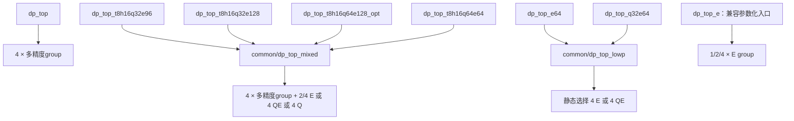

> 功能：七种 DP 架构相对基线的修改点和代码/spec导航；范围：七种架构入口、dp_top_e兼容入口与top/common复用模块；版本：v1.10；修改时间：2026-11-12 18:45:46 +0800；对应代码：src/verilog/top/下八个顶层、src/verilog/top/common/下共用核心与对齐模块；CModel入口src/cmodel/lib/json_io.cpp。

# 七种架构、八个顶层入口

七种架构包括原 `dp_top` 和新增 Q 专用扩展 `dp_top_t8h16q64e64`，另保留 `dp_top_e` 参数化兼容入口，所以 `src/verilog/top/` 根目录共八个 `.v` 文件。`dp_top_t8h16q32e128` 与 `dp_top_t8h16q64e128_opt` 分别扩展 E 和 Q/E，**两者均保留**；未优化的 `dp_top_t8h16q64e128` 不作为现用入口。

下文采用默认 LOCAL_W=28、GLOBAL_W=40。T=TF32；H=FP16/BF16；Q=MXFP8 E4M3/E5M2、MXFP6 E3M2/E2M3；E=MXFP4/NVFP4/HiF4。各模式容量是单笔请求的原生点积项数，不能同时相加。全部保持 L8/II=1，C在DP内部只累加一次。

既有六种架构的原生可编辑图见 [draw.io 图纸索引](../draw.io/README.md)：分别展示 DP → group → 两条 lane 的嵌套结构、S1–S8 计算分工及基础/扩展参与关系。每种架构独立一个 `.drawio` 文件，重复 group 用叠层与数量标识。

**本批范围：基础dp_top保留v1.8并独立修复DC电气违例；三个混合顶层和Q32E64实施v1.9；E64与dp_top_e保留旧设计。实现、验证与PPA状态分别记录，版本名不等于验收通过。**

三种混合架构的合同见[v1.9](mixed-precision-expansion.md)：E在S3消费e2、LZD22/U31输出；QE在S4消费e2且E旁路Q对齐；S5双指数；2/4扩展组均carry-save合并，双行MUX后唯一CPA。1:2:6为S43，1:2:8和1:4:8为S44。Q32E64复用新版QE，五源CSA后端为S43，见[低精度装配](low-precision-tops.md)。

## 1. 目录与入口

```text
src/verilog/top/
├── dp_top.v                      # 基线 T8H16Q32E64
├── dp_top_t8h16q32e96.v           # 基线 + 2个 E group
├── dp_top_t8h16q32e128.v          # 基线 + 4个 E group
├── dp_top_t8h16q64e128_opt.v      # 基线 + 4个紧凑 QE group
├── dp_top_t8h16q64e64.v          # 基线 + 4个 Q-only group
├── dp_top_e64.v                  # 4个 E group
├── dp_top_q32e64.v               # 4个紧凑 QE group
├── dp_top_e.v                    # 兼容：参数化 E16/E32/E64
└── common/
    ├── dp_top_mixed.v            # 四种混合扩展的实现核心
    ├── dp_top_lowp.v             # 两种专用低精度DP的实现核心
    ├── dp_global_align.v         # 全参与源的全局对齐
    ├── dp_mixed_global_align.v   # 带基础/扩展参与屏蔽的全局对齐
    └── README.md
```

filelist依然在 `src/verilog/files*.f`。仿真、导出和综合选根目录中的具体入口，其依赖由清单显式列出；common模块不另算一种容量架构。现有module名保持不变，改变的是文件归属路径。

## 2. 七种架构相对 dp_top 的修改点

| 顶层及源码 | S1–S5前端组成 | T/H/Q/E容量 | INT8 | S6物理源数（含C） | S7总宽 | A/B各宽 |
| --- | --- | --- | ---: | ---: | ---: | ---: |
| [dp_top](../../../verilog/top/dp_top.v) | 4×dp_group | 8/16/32/64 | K32 | 5 | 43 | 256 |
| [dp_top_t8h16q32e96](../../../verilog/top/dp_top_t8h16q32e96.v) | 原4组＋2×dp_group_e | 8/16/32/96 | K32 | 7 | 43 | 384 |
| [dp_top_t8h16q32e128](../../../verilog/top/dp_top_t8h16q32e128.v) | 原4组＋4×dp_group_e | 8/16/32/128 | K32 | 9 | 44 | 512 |
| [dp_top_t8h16q64e128_opt](../../../verilog/top/dp_top_t8h16q64e128_opt.v) | 原4组＋4×dp_group_qe(COMPACT_UNPACK=1) | 8/16/64/128 | K32 | 9 | 44 | 512 |
| [dp_top_t8h16q64e64](../../../verilog/top/dp_top_t8h16q64e64.v) | 原4组＋4×dp_group_q | 8/16/64/64 | K32 | 9 | 44 | 512 |
| [dp_top_e64](../../../verilog/top/dp_top_e64.v) | 4×dp_group_e，替换原多精度组 | —/—/—/64 | 不支持 | 5 | 43 | 256 |
| [dp_top_q32e64](../../../verilog/top/dp_top_q32e64.v) | 4×dp_group_qe(COMPACT_UNPACK=1)，替换原多精度组 | —/—/32/64 | 不支持 | 5 | 43 | 256 |

### 原 dp_top：比较基线

四个多精度group在S5输出token。S6通过dp_global_align对四个组结果和一份C做MAX、净移位、符号恢复；S7五项完整规约；S8做FP32编码或INT32回绕。原group/lane仍支持T/H/Q/E/INT8。原top还允许K_FP16=4/8/16，本表以默认K16比较；其他六种固定架构采用K16兼容规模索引。

入口：[模块层级](module-hierarchy.md)、[逐级流水](pipeline.md)、[逐级S/I/F](../common/stage-formats.md)、[全局对齐](global-align.md)。

### dp_top_t8h16q32e96：只增加 E 算力

保留原四个dp_group，新增两个dp_group_e，每组贡献E16；新增的高128-bit A/B仅用于E。Q/T/H/INT8仍只使用基础四组。

主要变化在顶层：S6从五源变七源，增加扩展支MAX和两路对齐；S7将基础五项的carry-save两行与新增两项做4:2压缩，双行MUX后唯一CPA，完整总宽仍为43。参与标志随请求逐级保存，非E请求旁路扩展MAX/加法并屏蔽扩展特殊值、负零摘要。基础group明确启用已验收v1.8计算。

入口：[混合扩展合同](mixed-precision-expansion.md)，重点看第3节输入分发、第4–6节参与/MAX/规约；新增前端看 [E lane](../lane/dp_lane_E.md)、[E group](../group/dp_group_E.md)。

### dp_top_t8h16q32e128：更多 E group，Q容量保持32

保留原四组，新增四个dp_group_e，高256-bit A/B仅用于E。S6扩为九源，S7扩展四项先4:2，与基础两行再4:2、双行MUX后唯一CPA，总宽增至44，S8相应处理44位总和。T/H/Q/INT8仍走基础支。与E96的主要差别是扩展组数、输入宽度、对齐源数和规约增长位；与优化Q64E128的差别是新增组不处理Q。

入口：[混合扩展合同](mixed-precision-expansion.md) 的E128配置、[E group](../group/dp_group_E.md)。复用核心配置为EXT_GROUPS=4、EXT_QE=0。

### dp_top_t8h16q64e128_opt：同时增加 Q 和 E 算力

保留原四组，新增四个紧凑dp_group_qe，每组支持Q8/E16。因此Q扩为64，E扩为128；T/H/INT8仍为原容量。S6九源、S7总宽44，与E128物理源数相同，但参与条件从仅E变成Q或E。

新增QE组有Q指数计算、公共MAX和局部对齐。优化版使用固定字段QE解包，提前形成配对符号/分类摘要以压缩S1寄存；扩展源使用浮点落位，裁掉扩展支的INT8选择。基础多精度四组保留INT8。参数为EXT_GROUPS=4、EXT_QE=1、OPTIMIZE_QE=1。

入口：[QE lane](../lane/dp_lane_qe.md)、[QE group](../group/dp_group_qe.md)、[混合扩展及优化实现](mixed-precision-expansion.md) 第2、4–7节。对应解包模块为dp_lane_unpack_qe/dp_operand_unpack_qe。

### dp_top_t8h16q64e64：只增加 Q 算力

保留四个基础组，新增四个 [Q8 group](../group/dp_group_q.md)，各含两条 [Q4 lane](../lane/dp_lane_q.md)。新增组只支持 MXFP8 E4M3/E5M2、MXFP6 E3M2/E2M3，删除 E pair、HiF4 元数据与 scale 尾数乘法。S4 lane 出口及 S5 group token 与既有 Q 路径兼容。

采用 EXT_GROUPS=4、EXT_Q_ONLY=1，仅 Q 请求启用扩展；T/H/E/INT8 的扩展 MAX、数值、特殊值、负零贡献分别屏蔽。S6 九源、S7 S44 carry-save 合并和唯一 CPA、S8 编码，保持 L8/II=1。E 容量为 64，不因物理输入扩宽而增加。

入口：[v1.10 合同](t8h16q64e64.md)。[新功能回执](../../../../test/results/q-only-v1.10-20261112.md)已通过，与旧六架构 PPA 分开；尚无该顶层的面积、时序或功耗测量。E192/E256 尚未实现，见[后端扩展分析](e192-e256-expansion-analysis.md)。

### dp_top_e64：四组全部使用 E 专用前端

将原四个多精度group换为四个dp_group_e，合法类型缩减为三种E；C/D固定FP32。E前端使用窄整数路径：S2乘法＋pair、S3 lane规约、S4组和/符号分离、S5 scale/LZD。保留E64容量，同时省去T/H/Q/INT8前端。

顶层不需要基础/扩展分支和按格式参与掩码；每笔合法请求四组都工作。S6仍五源、S7仍43位，复用浮点后端算术；去掉INT32 C/落位/输出选择。QE_FRONTEND=0静态选择E组。

入口：[低精度顶层](low-precision-tops.md)、[E lane](../lane/dp_lane_E.md)、[E group](../group/dp_group_E.md)。

### dp_top_q32e64：四组全部使用 QE 专用前端

将原四组换为四个紧凑dp_group_qe，仅保留Q/E，容量仍Q32/E64；去掉T/H/INT8。QE保持S2乘积/指数、S3局部对齐或E pair、S4 lane树、S5组和/abs/scale/LZD的计算组织，并采用COMPACT_UNPACK=1。

顶层与E64共用五源浮点后端和控制，S6五源、S7总宽43，C/D为FP32，无扩展支屏蔽。QE_FRONTEND=1静态选择QE组。

入口：[低精度顶层](low-precision-tops.md)、[QE lane](../lane/dp_lane_qe.md)、[QE group](../group/dp_group_qe.md)。

四个混合扩展的基础支直接实例化四个dp_group；C与S6–S8由混合核心统一组织。所有前端在S5交付公共token接口。E前端HiF4可使用不同于多精度/QE的定点坐标，后端以magnitude/anchor/z解释数值，不要求各前端token字段逐位相同。

## 3. 共用核心与兼容入口的职责

| 模块及实际路径 | 职责 / 使用者 |
| --- | --- |
| [common/dp_top_mixed.v](../../../verilog/top/common/dp_top_mixed.v) | E96、E128、优化Q64E128、Q64E64四种固定包装的完整实现核心，包含group装配、C流水、带参与屏蔽的S6–S8 |
| [common/dp_top_lowp.v](../../../verilog/top/common/dp_top_lowp.v) | E64/Q32E64两种包装的完整实现核心，静态选择E/QE组，组织C与五源浮点后端 |
| [common/dp_global_align.v](../../../verilog/top/common/dp_global_align.v) | 基线、兼容E、lowp核心使用的组合对齐模块；顶层持有S6寄存器 |
| [common/dp_mixed_global_align.v](../../../verilog/top/common/dp_mixed_global_align.v) | mixed核心使用的组合对齐模块；处理基础/扩展MAX及逐源参与屏蔽，核心持有S6寄存器 |
| [dp_top_e.v](../../../verilog/top/dp_top_e.v) | 原参数化E-only完整实现：K_FP16=4/8/16对应E16/E32/E64，保留兼容回归和历史实验入口 |

带容量名称的六个固定top是薄包装，静态选择共用核心的配置；包装不增加流水。dp_top与dp_top_e自身是完整实现。dp_top_e64默认数值合同与dp_top_e的E64配置相同，但现有代码分别由lowp核心和旧参数化top组织，彼此没有实例化关系。

代码复用表示共用定义，各实例仍是独立硬件。七种架构不会在运行时共享同一批乘法器。`mixed`表示基础组加扩展组，`lowp`表示只含低精度组，`e64`明确固定E64容量。



## 4. 验证、源码清单和历史证据

| 顶层 | 源清单（src/verilog/） | 验证入口 |
| --- | --- | --- |
| dp_top | files.f | test/run_verilog.py --implementation verilog --phase all |
| dp_top_t8h16q32e96 | files_t8h16q32e96.f | test/run_mixed_verilog.py --frontend t8h16q32e96 |
| dp_top_t8h16q32e128 | files_t8h16q32e128.f | test/run_mixed_verilog.py --frontend t8h16q32e128 |
| dp_top_t8h16q64e128_opt | files_t8h16q64e128_opt.f | test/run_mixed_verilog.py --frontend t8h16q64e128_opt |
| dp_top_t8h16q64e64 | files_t8h16q64e64.f | test/run_mixed_verilog.py --frontend t8h16q64e64 |
| dp_top_e64 | files_e64.f | test/run_lowp_verilog.py --frontend e64 |
| dp_top_q32e64 | files_q32e64.f | test/run_lowp_verilog.py --frontend q32e64 |
| dp_top_e（兼容） | files_e.f | test/run_verilog.py --implementation verilog --frontend e --phase all |

命令的构建环境见 [Verilog README](../../../verilog/README.md) 和 [test README](../../../../test/README.md)。CModel使用已实现的对应profile，共用精确数学reference。

既有六架构的最新已测结果见 [v1.9 DC 索引](../../../../hw/dc_syn/records/v19_six_dp_20261110.md)与[功耗交付](../../../../hw/power/records/v19_design_report_20261110.md)。历史数值保留，原始大产物的可用状态以 DC/power records 的 README 和清理回执为准。

Q 专用扩展独立导出、验证；不能继承 Q64E128 或原六架构的 PPA 结论。共享核心的默认关闭参数保留既有装配行为，回归范围及新快照以本轮验证记录为准。
