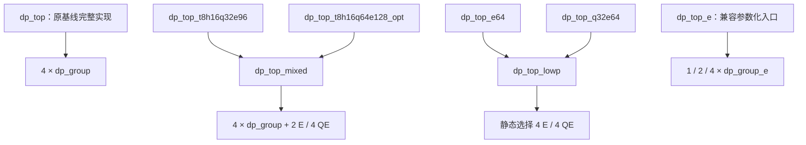

> 功能：五种现用 DP 架构对比与顶层角色导航；范围：基线、E96、优化 Q64E128、E64、Q32E64，共用核心和兼容入口；版本：v1.7.5；修改时间：2026-11-08 09:15:35 +0800；对应代码：src/verilog/top/dp_top.v、dp_top_t8h16q32e96.v、dp_top_t8h16q64e128_opt.v、dp_top_e64.v、dp_top_q32e64.v、dp_top_mixed.v、dp_top_lowp.v、dp_top_e.v；CModel 入口 src/cmodel/lib/json_io.cpp。

# 五种现用 DP：从综合入口读到共享实现

“现用五种”包含原多精度 dp_top。所有容量均为一笔请求原生完成的点积项数，各模式不能同时相加。默认 LOCAL_W=28、GLOBAL_W=40，全部保持 L8/II=1，C 在 DP 内只加一次。Q 包含 MXFP8 E4M3/E5M2、MXFP6 E3M2/E2M3；E 包含 MXFP4/NVFP4/HiF4。

## 1. 与原 dp_top 的架构差异

| 对外顶层（源码） | group 组成 | 每拍原生容量 T/H/Q/E | INT8 | S6物理源数（含C） | S7总宽 | A/B各宽 |
| --- | --- | --- | ---: | ---: | ---: | ---: |
| [dp_top](../../../verilog/top/dp_top.v) | 4×多精度 dp_group | 8/16/32/64 | K32 | 5 | 43 | 256 |
| [dp_top_t8h16q32e96](../../../verilog/top/dp_top_t8h16q32e96.v) | 原4组＋2×dp_group_e | 8/16/32/96 | K32 | 7 | 43 | 384 |
| [dp_top_t8h16q64e128_opt](../../../verilog/top/dp_top_t8h16q64e128_opt.v) | 原4组＋4×紧凑dp_group_qe | 8/16/64/128 | K32 | 9 | 44 | 512 |
| [dp_top_e64](../../../verilog/top/dp_top_e64.v) | 4×dp_group_e | —/—/—/64 | 不支持 | 5 | 43 | 256 |
| [dp_top_q32e64](../../../verilog/top/dp_top_q32e64.v) | 4×紧凑dp_group_qe | —/—/32/64 | 不支持 | 5 | 43 | 256 |

**E96/优化Q64E128是给原DP增加并行低精度分支。** 原四组保留T/H/Q/E/INT8；新增组仅在本笔支持的模式下参与。E96在E模式启用两组扩展，Q64E128在Q/E模式启用四组扩展。S6用基础支/扩展支的MAX得到同一个公共指数，再对各源移位；S7两支求和并按类型合并/旁路。高精度和INT8不使用新增组，非参与源的指数、特殊值、负零摘要均屏蔽。扩展增加了物理对齐源、规约宽度/分支以及相关寄存器。

**E64/Q32E64是将原四个多精度group替换为专用group。** 不保留T/H/INT8功能，也没有“基础支＋扩展支”的动态参与选择。每个合法请求四组均参与，四个token和一份FP32 C进入共用五源后端，S7输出43位，S8输出FP32。它们的优势主要是前端功能裁剪；完整DP仍须承担C、五源对齐、累加和舍入开销。

共用group接口只要求S5 token的数值合同相同，不要求所有字段逐位相同：E前端HiF4可使用不同于多精度/QE的内部定点坐标；S6以magnitude/anchor/z解释实际数值。参数推导和详细流水见 [低精度顶层](low-precision-tops.md)、[混合扩展](mixed-precision-expansion.md)。

## 2. 为什么 top 目录还有 mixed、lowp、e

| 文件/module | 角色 | 应如何使用 |
| --- | --- | --- |
| dp_top.v | 原多精度完整实现和对外入口 | 基线T8H16Q32E64；仍支持原K参数 |
| dp_top_mixed.v | 两个混合包装共用的完整实现核心 | 静态EXT_GROUPS/EXT_QE决定扩展组数和种类；OPTIMIZE_QE决定紧凑QE实现。综合/测试选具体包装，不把核心另算一种容量 |
| dp_top_lowp.v | E64/Q32E64共用的完整实现核心 | 静态QE_FRONTEND=0生成四个E组，=1生成四个紧凑QE组；共用五源后端，只生成选中的前端 |
| dp_top_e.v | 原E-only参数化完整实现，保留兼容 | K_FP16=4/8/16对应E16/E32/E64；历史回归与旧实验使用此入口。不是给dp_top再增加E算力 |
| dp_top_e64.v | 固定E64对外薄包装 | 实例化dp_top_lowp(QE_FRONTEND=0)，固定四组；新E64集成与综合优先用这个名称 |
| dp_top_q32e64.v | 固定Q32E64对外薄包装 | 实例化dp_top_lowp(QE_FRONTEND=1)，固定四组 |

实际文件叫 `dp_top_mixed.v`，没有 `dp_top_mix.v`；也没有 `dp_top_lowp_e.v` 或 `dp_top_e_64.v`。`lowp` 表示低精度共用核心，`e` 表示E-only前端，`e64`明确固定E64容量。它们不是串联的多个DP，包装也不额外增加流水级。

核心模块共用源码，实例化时形成各自独立硬件；这不表示不同DP实例在运行时共享同一批乘法器。dp_top_e与dp_top_e64在默认E64下使用相同E组和后端算术合同，但目前是两个独立顶层组织，并非前者包裹后者。

## 3. 从哪里查看细节

| 关注点 | spec / 入口 |
| --- | --- |
| 原多精度DP每一级 | [pipeline](pipeline.md)、[module-hierarchy](module-hierarchy.md)、[common/stage-formats](../common/stage-formats.md) |
| E96/Q64E128：扩展使能、MAX、分支树、旁路 | [mixed-precision-expansion](mixed-precision-expansion.md) |
| E64/Q32E64：四组+C、前端切换、五源后端 | [low-precision-tops](low-precision-tops.md) |
| E的窄流水与scale | [E lane](../lane/dp_lane_E.md)、[E group](../group/dp_group_E.md) |
| QE的能力裁剪与紧凑解包 | [QE lane](../lane/dp_lane_qe.md)、[QE group](../group/dp_group_qe.md)、[优化实现](mixed-precision-expansion.md) |
| S6全局移位数与符号恢复 | [global-align](global-align.md) |
| 命令、源清单、验证 | [Verilog README](../../../verilog/README.md)、[test README](../../../../test/README.md) |

源清单分别为 files.f、files_t8h16q32e96.f、files_t8h16q64e128_opt.f、files_e64.f、files_q32e64.f。兼容入口dp_top_e使用files_e.f，保留但不算第六种新的架构方案。

## 4. 源码退役与证据边界

v1.7.5删除现用源码中的dp_top_t8h16q32e128和未优化dp_top_t8h16q64e128、各自files清单及配置。新测试/导出只提供E96和优化Q64E128两个混合profile。CModel保留旧profile的数学实现别名供历史回放；旧snapshot、网表、综合报告和测试数据不删除、不改写。

本次仅调整入口集合和文档，保留的RTL数据通路不变，不重新宣称PPA测量。已有同工况面积/时序来源为 [原混合比较](../../../../hw/dc_syn/records/mixed_n12_1000mhz_20261108.md)、[QE优化](../../../../hw/dc_syn/records/qe_area_opt_n12_1000mhz_20261108.md)、[四组低精度](../../../../hw/dc_syn/records/lowp_n12_1000mhz_20261108.md)。历史报告中出现退役名字属于其当时的真实实验，不是当前入口。

测试选择/门禁目录发生变化后，新EDA运行应重新生成当前验证回执；原报告仍绑定原快照和回执，不能手改其fingerprint/ppa_eligible来跳过新门禁。

本次目录整理检查：五种现用顶层及dp_top_e兼容入口的Verilator lint通过；5项混合CModel检查、41项流程/门禁测试通过；退役profile的CLI和新导出均拒绝。没有改动保留的RTL计算路径，未执行新的DC测量。
