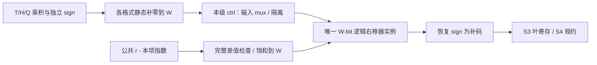

> 功能：定义固定物理移位器的 mux 复用；范围：lane S3 T/H/Q 共享、E/INT 旁路、局部位宽与规约入口；版本：v1.5.4；修改时间：2026-11-05 14:16:26 +08:00；对应代码：[CModel lib/lane.cpp](../../../cmodel/lib/lane.cpp)；分组主方案手写 RTL：[dp_lane.v](../../../verilog/lane/dp_lane.v)；Chisel 尚未实现。

# lane 局部共享幅值移位器

状态：用户明确要求固定物理移位器，由输入 mux 选择格式；每 lane 四个共享幅值移位器，位宽由 LOCAL_W 统一设置，默认为 28。

## 1. S3 的物理资源

一个 T1H2Q4E8 lane 同拍最多处理四个 Q 乘积，所以需要四个并行移位器实例。每一个实例同时覆盖 T/H/Q 的互斥用途，不能为 TF32、FP16、BF16、Q 分别实例化一套，再在输出做 mux 并称为共享。主配置 G=4、lane 数=2G，共 `2G×4=32` 个局部共享移位器；这是结构需求，综合后的 cell 数和面积另行测量。



四个实例采用下列固定路由，索引从 0 开始；其他等价置换必须在导出映射中明确，不能破坏 sign/delta 对应关系。

| 本笔模式 | shifter[0] | shifter[1] | shifter[2] | shifter[3] |
| --- | --- | --- | --- | --- |
| TF32 | T 尾数积 0 | 隔离 | 隔离 | 隔离 |
| FP16/BF16 | H 尾数积 0 | H 尾数积 1 | 隔离 | 隔离 |
| MXFP8/6 | Q 尾数积 0 | Q 尾数积 1 | Q 尾数积 2 | Q 尾数积 3 |
| MXFP4/NVFP4/HiF4 | 宽移位器隔离 | 宽移位器隔离 | 宽移位器隔离 | 宽移位器隔离 |
| INT8 | 宽移位器隔离 | 宽移位器隔离 | 宽移位器隔离 | 宽移位器隔离 |

E 使用 S3 的四个 pair 和及小范围精确移位支路，INT8 使用结构落位支路，两者从叶节点选择 mux 接入同一 S4 树。E 的 HiF4 位移仅 0/1/2，是带保护低零的窄移位；不能额外生成四个全范围宽 barrel shifter。是否让 E 小范围选择也合入同一物理大移位器可另作 PPA 变体，但必须保持逐级数值合同。

## 2. 位宽的唯一配置来源

```text
local_shift_mag_width = 可配置无符号幅值窗口 W，默认 28
product_integer_bits = 2                         // T/H/Q 乘积范围推导
local_align_fraction_bits = W - product_integer_bits
local_signed_width = W + 1
local_shift_control_bits = ceil(log2(W+1))
shifters_per_lane = elements_per_lane_Q
```

`local_shift_mag_width` 是局部移位精度的主配置项；`local_align_fraction_bits` 改为派生量，二者不能作为互相矛盾的独立输入。默认 W=28、F=26；合法下界 W=`product_integer_bits+retain_main_fraction_bits=2+25`=27。当前合法基线要求 F≥25，并满足全部模式的静态补零、E/INT 共享槽以及后级窗口约束；不任意给出未验证的扫描上限。改变 W 会传导到 W_leaf/W_lane/W_group、各模式 F、组 magnitude、anchor 修正、全局窗口合法性和测试参考，不能只改移位器端口。

T/FP16 尾数积为 W22/F20，输入左补的结构低零数是 F-20；BF16 为 F-14；Q 为 F-6。左侧补零/扩宽与低侧补零是不同操作；输入 mux 的每个候选都必须有明确 F，不依靠赋值自动截断。W 位幅值输出恢复符号后为 W+1 位补码。[S6 全局双向移位](../dptop/global-align.md) 由 GLOBAL_W 独立配置，幅值口为 GLOBAL_W-1。

## 3. 移位单元语义与组合接口

下表定义 S3 的组合逻辑右移单元，也可作为 S6 双向网络的共享内核；S6 完整外层增加方向控制，见 [dptop/global-align.md](../dptop/global-align.md)。算术单元不暗加 valid 寄存或 ready，阶段拥有寄存边界。

| 字段 | 宽度 / 定义 |
| --- | --- |
| in_magnitude | UInt(width)，进入移位器前已经完成格式落位 |
| in_shift | UInt(ceil(log2(width+1)))，0..width；width 表示全部移出 |
| in_active | 1，所属阶段 valid 且本笔格式使用本实例 |
| out_magnitude | UInt(width)，逻辑右移结果；shift≥width 为 0 |

上层 delta 按指数完整范围计算，再 `min(delta,width)` 饱和至端口，不能截断 delta 高位造成模回绕。输入隔离在 mux/算术入口实施：无效/不使用时固定数据与 shift 为零，或者保持已证明不会激活的局部输入；不能仅把输出设零而让所有候选移位器仍切换。

局部移位处理无符号幅值，故右移就是向零截断。负号在移位后恢复；补码树所需的负数变换另属 sign-convert 逻辑，不将负数算术右移当作 RTZ。移出位可供验证统计，首版不作为跨级 sticky 注入最终 RNE。

## 4. 结构与功能验收

后续必须检查输入 mux 后确实仅有四个 W 位局部移位实例/lane，T/H/Q 不并存格式专用的额外宽移位器；分别记录 mux/isolation、shift、sign-convert、寄存器的实际成本。综合优化可以消除恒零路径，不能未经记录复制算术资源。RTL 结构、映射网表和最终资源表分别留证据，源码实例数不等于物理门数。

验证覆盖 T/H/Q 每个活动槽、sign/delta 对应、正负小数 RTZ、delta=0/W-1/W/W+1 及远大于 W 的差值；穿插模式切换与 bubble；参数改变后逐级 F 和 anchor 的数值等价检查。E/INT 旁路要检查宽移位器确实被隔离。当前已做 CModel 数值检查；物理资源隔离及共享仍需 RTL 结构/功耗验证。


E 专用候选的 lane 内 e2 融合与小左移见 [dp_lane_E.md](dp_lane_E.md)，与本页多精度主实现分别定义。
