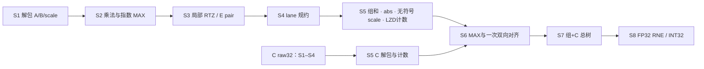

> 功能：定义分组共享 DP 的流水候选；范围：S1–S8、INT32 共用输出和时序待决项；版本：v1.5.1；修改时间：2026-11-05 11:37:59 +08:00；对应代码：[CModel lib/model.cpp](../../cmodel/lib/model.cpp)；分组主方案手写 RTL：[dp_top.v](../../verilog/top/dp_top.v)；Chisel 尚未实现。

# 分组共享 DP：八级流水

默认所有格式共用 L8 寄存边界，目标 II=1。下表为 v1.5 的 RTL/CModel 流水切分。 [架构图](draw.io/dp_arch.drawio)

## 1. 流水分工

| 级 | 数据路径 | 指数与控制 |
| --- | --- | --- |
| S1 | A/B/scale 解包；HiF4 e1 融合；INT8 符号/幅值 | 分类特殊值，采样逐笔 datatype/last；C 仅保留 raw32 |
| S2 | 每 lane 两组 HH/HL/LH/LL；重构 T/FP16 及 INT8 乘积 | 元素指数相加、两 lane 基本组 MAX；预计算 scale 指数和及 4×4 系数积 |
| S3 | 四个共享幅值移位器，默认 W28；E pair 和精确小移位；INT 结构落位 | delta 由基本组公共 r 产生；RTZ 后恢复符号 |
| S4 | 四路平衡树；Q/E/INT 四项，H 末层，T 旁路 | SOP、r、scale、特殊摘要和控制同拍 |
| S5 | 两 lane 合并；分离符号与幅值；NVFP4/HiF4 公共 14×8 无符号 scale 乘法；其他模式旁路；LZD 只计数 | 输出原幅值/A_raw/z；并行解包 C 并检测非正规计数 |
| S6 | 原幅值静态补零；按 net 一次双向移位；恢复补码 | e=A_raw−z，E_max=max(e)，d=E_max−e，net=z−d |
| S7 | G 个组与 C 共同求和，保留完整增长 | G+1 个叶，K4/K8/K16 分别为 2/3/5 项 |
| S8 | FP32 的 abs/LZD/norm/RNE，或 INT32 回绕 | 最终特殊结果 mux；输出 valid/type/last |

C 在输入沿与 A/B 共同接收，S1–S4 只保存顶层一份 raw32；S5 C 解包是独立并行支路，不串接在 scale 乘法之后。每个请求的控制和特殊摘要与数据同行。

## 2. 指数侧关键边界

S2 的两 lane MAX 回传属于同周期有向组合路径。候选指数不依赖返回 MAX，因此没有组合环。S2 注册共同 r 与各项指数，S3 计算 delta 并移位；不得各 lane 使用不同坐标后在 S5 直接相加。

S5 已经扣除元素与 scale 偏置，形成 A_raw，但实际指数还依赖 scale 后 LZD 计数。S6 计算 e 并选择 E_max；可直接用 A_raw−E_max 形成 net，避免 MAX 后串联两次减法。若以后将 e 提前寄存，必须同步记录接口和阶段变化。

## 3. 观察时刻与备用级

沿 n 接收，S1 于 n 更新，S8 于 n+7 更新；沿 n+8 更新前观察输出，记 L=8。CModel step 与 RTL TB 使用相同相位，不额外添加结果队列。

静态参数`post_scale_norm_extra_stage=1`提供 L9 探索：S5 完成组和/abs/无符号 scale/原 anchor/C 解包；新增 S6 仅 LZD 计数，后续全局对齐、总树和编码顺延一级。所有格式、C 与控制一起延迟，数值与 L8 一致。默认数据及 golden 仍为 L8。

## 4. 时序验收重点

| 路径 | 需要核验的组合链 |
| --- | --- |
| S2 | 部分积重构；指数加法→lane MAX→基本组 MAX |
| S3 | delta→共享移位→符号转换；E pair→小范围移位 |
| S5 | 组和→abs→无符号 scale 乘法→LZD 计数 |
| S6 | e 生成→MAX→net→方向选择/移位→符号转换 |
| S7 / S8 | 最多五项宽位规约；总和 abs/LZD/norm/RNE 进位 |

功能块拆分不能暗增流水级。允许实现层进行等价组合优化，但必须保持截断点、位宽、公共指数及[逐级出口](stage-formats.md)合同。
